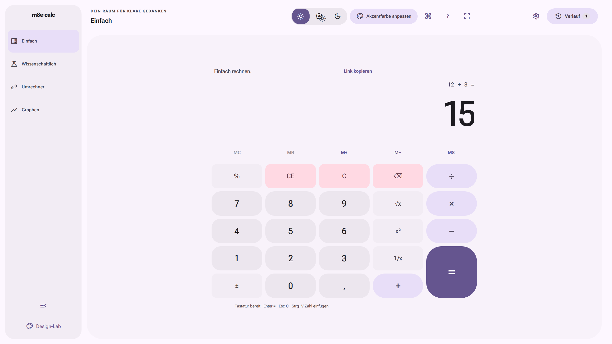
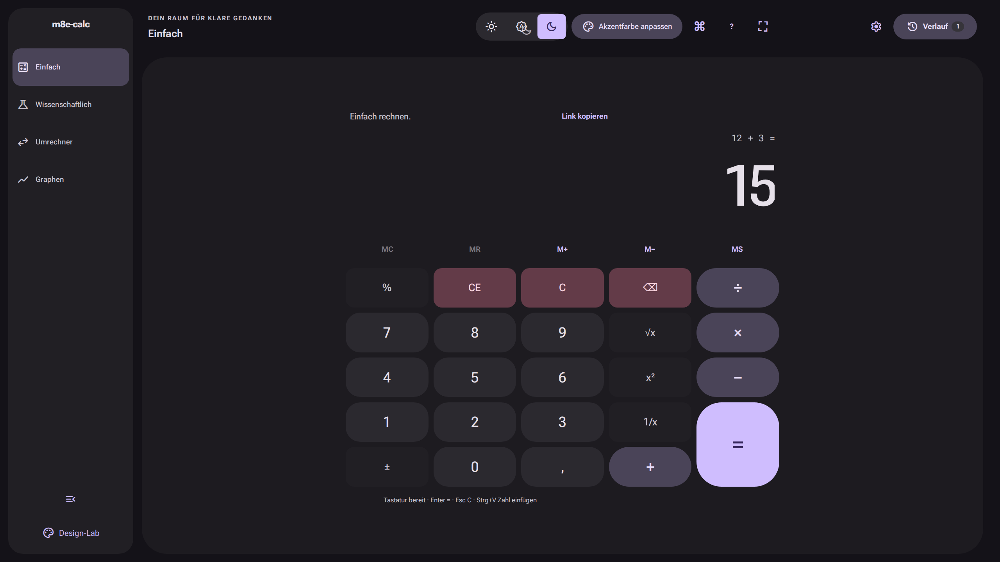
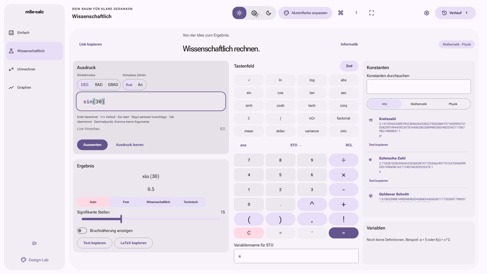
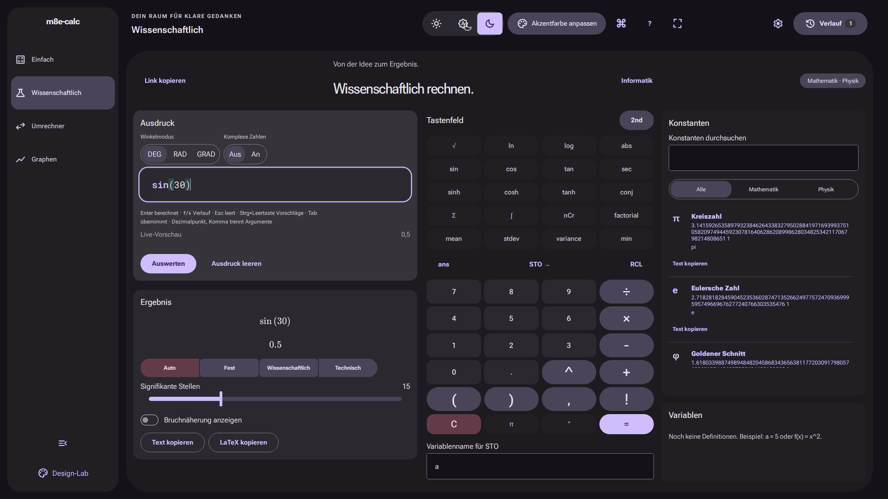
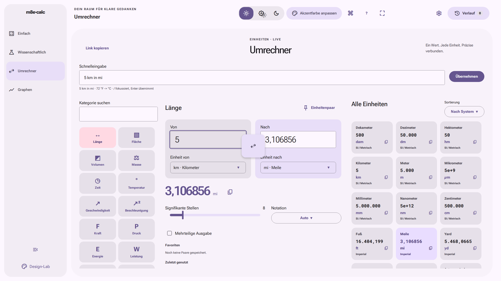
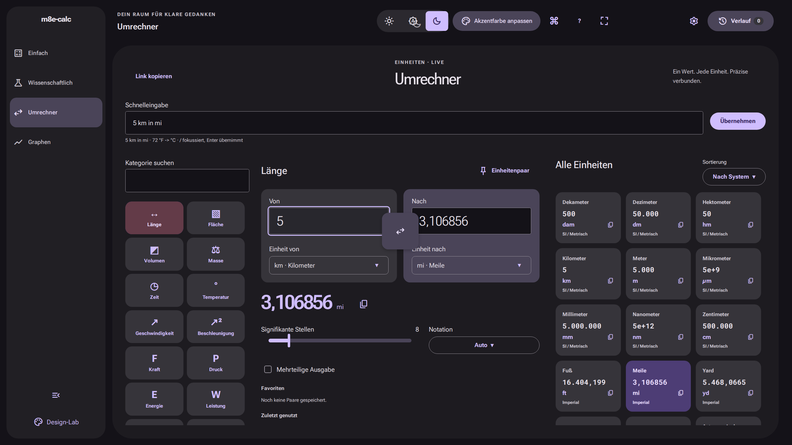
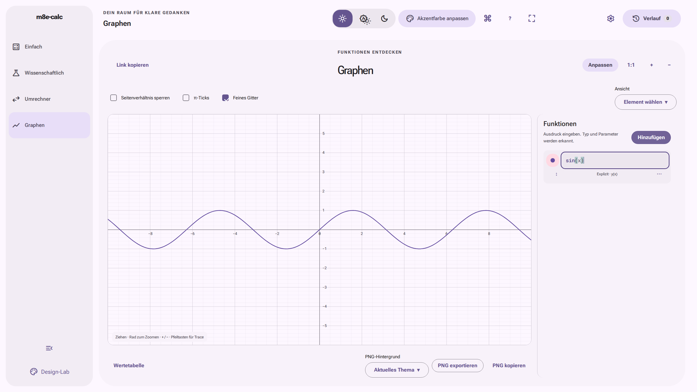
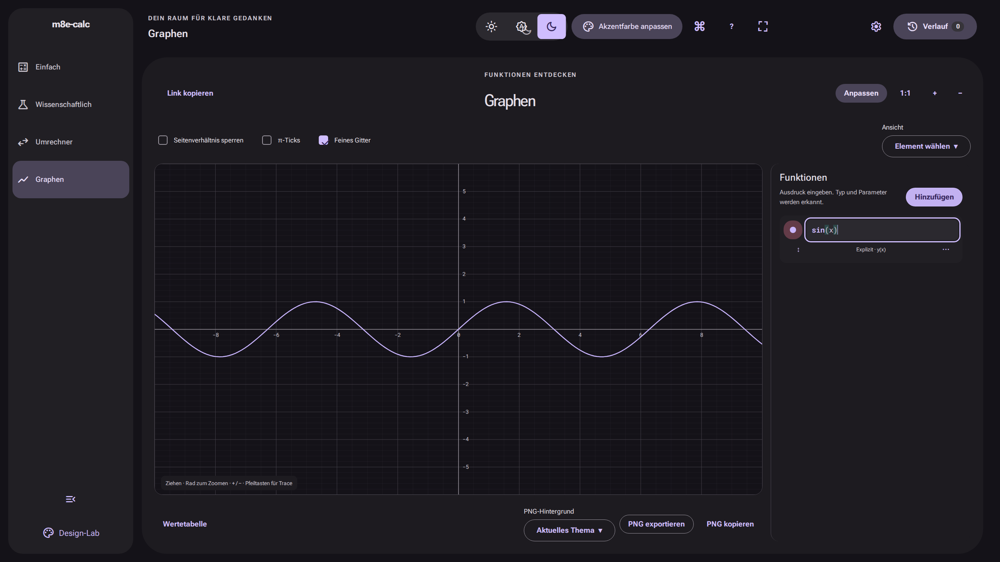

# m8e-calc

Ein Taschenrechner für den Desktop-Browser: vom schnellen Dreisatz bis zu wissenschaftlichen Ausdrücken, Einheiten und interaktiven Funktionsgraphen. m8e-calc rechnet lokal, benötigt kein Konto und bietet eine deutsche und englische Oberfläche.

**[Jetzt im Browser öffnen](https://sl3ndrr.github.io/m8e-calc/)** · [Dokumentation](docs/ARCHITECTURE.md) · [Änderungen](CHANGELOG.md)

## Vier Modi

| Modus                | Funktionen                                                                                                                                                                                                                       |
| -------------------- | -------------------------------------------------------------------------------------------------------------------------------------------------------------------------------------------------------------------------------- |
| **Einfach**          | Grundrechenarten, Prozent, Vorzeichen, Speicher und Tastaturbedienung für alltägliche Rechnungen.                                                                                                                                |
| **Wissenschaftlich** | Ausdruckseditor mit Vorschlägen, DEG/RAD/GRAD, komplexe Zahlen, Konstanten, Variablen und eigene Funktionen; Summen, Integrale und Ableitungen. Informatik-Panel mit BigInt-Wörtern, Bitraster, Zahlbasen, IEEE-754 und Unicode. |
| **Umrechner**        | 286 Einheiten in 32 Kategorien, Suche, Favoritenpaare, beidseitige Eingabe und Schnelleingaben wie `5 km in mi` oder `3 ft 4 in`.                                                                                                |
| **Graphen**          | Explizite, parametrische und polare 2D-Kurven, Parameterslider, Pan/Zoom, Trace, Nullstellen, Extrema, Schnittpunkte, Tangenten, Integrale, Wertetabellen und PNG-Export.                                                        |

Alle Modi teilen Verlauf mit Suche, Pins und JSON-Export, Befehlspalette, Permalinks und Einstellungen. Hell/System/Dunkel, Akzentfarbe, UI-Größe und Präsentationsmodus passen die Arbeitsfläche an. Nach dem ersten vollständigen Laden ist die App offline nutzbar; unterstützte Browser bieten eine PWA-Installation an.

Numerische Analysis ist näherungsweise. Genauigkeitsgrenzen stehen in [ENGINE.md](docs/ENGINE.md) und [GRAPH.md](docs/GRAPH.md). Implizite Kurven bleiben Folgearbeit. Optionale EZB-Währungskurse sind nach
ausdrücklichem Opt-in verfügbar; ohne Zustimmung erfolgen keine Währungsrequests.

## Screenshots

Dokumentationsaufnahmen aus der Releasevorbereitung AP16 mit deutschen
Beispielrechnungen, jeweils **2560 × 1440**, reproduzierbar mit `npm run screenshots`.
Aktuelle Abnahmebilder und ihr geprüfter SHA: [AP25](docs/AP25.md).
Weitere Modi: [Bildverzeichnis](docs/img).

| Hell                                                                          | Dunkel                                                                        |
| ----------------------------------------------------------------------------- | ----------------------------------------------------------------------------- |
|               |               |
|  |  |
|                      |                      |
|                          |                          |

## Tastenkürzel

Globale Rechnerkürzel gelten außerhalb von Eingabefeldern und Dialogen; die Palette ist auch im Editor erreichbar. Die vollständigen Fokusregeln und Kürzel stehen in [COMFORT.md](docs/COMFORT.md).

| Taste                                     | Aktion / Bereich                                             |
| ----------------------------------------- | ------------------------------------------------------------ |
| Strg+K / Cmd+K                            | Befehlspalette, alle Modi                                    |
| `?`                                       | Kürzelübersicht                                              |
| Alt+1 / Alt+2 / Alt+3 / Alt+4             | Einfach / Wissenschaftlich / Umrechner / Graphen             |
| Strg+H                                    | Verlauf ein-/ausblenden                                      |
| Strg+,                                    | Einstellungen                                                |
| Strg+Umschalt+P                           | Präsentation ein-/ausschalten                                |
| Ziffern, `+`, `-`, `*`, `/`, `.` oder `,` | Einfach: Eingabe                                             |
| Enter / `=`                               | Einfach: auswerten                                           |
| Rücktaste / Entf / Esc / `%`              | Einfach: letzte Ziffer / CE / C / Prozent                    |
| Enter / ↑ / ↓ / Esc                       | Ausdruckseditor: auswerten / Verlauf / leeren                |
| Strg+Leertaste / Tab                      | Wissenschaftlicher Editor: Vorschläge / Vorschlag übernehmen |
| `/` / Strg+Umschalt+S                     | Umrechner: Schnelleingabe / Einheiten tauschen               |
| `+` oder `=` / `-`                        | Graph-Canvas: vergrößern / verkleinern                       |
| Pfeiltasten / Esc / Umschalt+F10          | Graph-Canvas: Trace bewegen / schließen / Aktionen           |

## Lokal entwickeln

Voraussetzungen: **Node.js 24 LTS**, npm und Git. Das Lockfile ist verbindlich.

```sh
git clone https://github.com/sl3ndrr/m8e-calc.git
cd m8e-calc
nvm use
npm ci
npm run dev
```

Die ausgegebene lokale URL verwendet standardmäßig den Pfad `/m8e-calc/`. Ohne nvm Node 24 auf anderem Weg installieren. Für einen anderen Hostingpfad `VITE_BASE_PATH` beim Build setzen (führender und abschließender Slash).

| Befehl                        | Zweck                                                                           |
| ----------------------------- | ------------------------------------------------------------------------------- |
| `npm run check`               | Lint, Format, Typen, Unit-/Komponententests, Build und Engine-/Graph-Benchmarks |
| `npm run build`               | Produktionsbuild in `dist/`                                                     |
| `npm run preview`             | Produktionsbuild lokal ausliefern                                               |
| `npm run test`                | Vitest mit Testing Library und Property-Tests                                   |
| `npm run test:e2e`            | Playwright (vorher Build und Browser installieren)                              |
| `npm run screenshots`         | Acht Release-Screenshots und Social Preview aus dem Produktionsbuild erzeugen   |
| `npm run screenshots:gallery` | Komponenten-Galerie aufnehmen; separaten Galerie-Preview vorher starten         |
| `npm run tokens`              | Material-Farbtokens regenerieren                                                |

```sh
npx playwright install chromium
npm run build
npm run screenshots
npm run test:e2e -- --project=chromium --project=chromium-graph-performance
```

Linux-CI benötigt gegebenenfalls `npx playwright install --with-deps chromium`. Der Screenshot-Befehl startet und beendet seinen eigenen lokalen Preview-Server. Ausgabe: `docs/img/`, einschließlich `social-preview.png` (1280 × 640). Details: [Release-Anleitung](docs/RELEASE.md). Weitere Browser- und Qualitätsprüfungen: [QA_REPORT.md](docs/QA_REPORT.md).

## Architektur

React orchestriert die Oberfläche; Berechnungen bleiben in browserfreien TypeScript-Domänen. Eingabe → UI-Reducer/Adapter → Domäne → Ergebnis → Store/Ansicht. Die vier Modi werden bei Bedarf geladen; Hash-Routing funktioniert auf statischem Hosting ohne Server-Rewrites.

| Verzeichnis                            | Verantwortung                                                    |
| -------------------------------------- | ---------------------------------------------------------------- |
| `src/app`                              | Bootstrap, Shell, Routing, Kürzel, Palette und Browseranbindung  |
| `src/features`                         | Oberflächen und Adapter der vier Modi                            |
| `src/engine`, `src/units`, `src/graph` | Rechenkern, Einheiten und Float64-Graph-Engine ohne React/DOM    |
| `src/ui`, `src/styles`                 | Zugängliche Komponenten, lokale Fonts und zentrale Design-Tokens |
| `src/shared`                           | Zustand, Persistenz und typisierte de/en-Texte                   |
| `e2e`, `scripts`                       | Browserprüfungen, Qualitätschecks und Asset-Erzeugung            |

Das interne Designlab ist bei `npm run dev` unter `#/design` erreichbar.
Für Galerie-Tests im Produktionspreview: `npm run build:gallery`, danach
`npm run test:e2e:gallery` oder `npm run preview:gallery` (Port 4174 für das
Galerie-Bildskript). Dieser Build liegt in `dist-gallery/`; der normale Build
und Pages verwenden ausschließlich `dist/`. Details: [Internes Designlab](docs/AP23.md).

Einstieg: [ARCHITECTURE.md](docs/ARCHITECTURE.md), [Produkt](docs/PRODUCT_SPEC.md), [Design](docs/DESIGN.md), [Komponenten](docs/COMPONENTS.md), [Roadmap](docs/ROADMAP.md). Fachverträge: [Engine](docs/ENGINE.md), [Einheiten](docs/UNITS.md), [Graphen](docs/GRAPH.md). Bedienung: [Wissenschaftlich](docs/SCIENTIFIC_MODE.md), [Umrechner](docs/CONVERT_MODE.md), [Graphen](docs/GRAPH_MODE.md), [Komfort](docs/COMFORT.md). Für Beiträge zuerst [AGENTS.md](AGENTS.md) lesen.

## Datenschutz

Keine Tracker, Analytics, CDNs oder externen Rechenservices. Ohne Währungs-Opt-in sendet die App keine externen Requests zur Laufzeit;
Code, Fonts und andere Assets kommen vom selben Hosting-Ursprung. Das erstmalige Laden und Updates erfordern Requests an diesen Host. Entwicklung und CI laden Pakete separat herunter.

Einstellungen, Verlauf, Definitionen und Favoriten bleiben im lokalen Browserspeicher. Offline-Dateien liegen im Service-Worker-Cache. Browserdaten lassen sich über die Website-Einstellungen des Browsers löschen. Ein kopierter Permalink enthält den ausdrücklich geteilten Moduszustand im URL-Hash, jedoch keinen gesamten Verlauf und kein gespeichertes Environment. Wer einen Link oder Export weitergibt, teilt dessen Inhalt selbst.

AP17 ist integriert: Nur der explizite Schalter „Online-Kurse laden“ erlaubt
Requests an den Frankfurter-EZB-Endpunkt. Beträge und Verlauf bleiben lokal;
Währungsberechnungen sind derzeit von Verlauf und Permalinks ausgeschlossen;
versionierte Snapshots bleiben Folgearbeit. Cache, Offline-Fallback und
Zustimmungsentzug sind dokumentiert in
[UNITS.md](docs/UNITS.md). Aktueller Integrations-/Abnahmestand: [AP25](docs/AP25.md).

## Tech-Stack und Credits

React 19, TypeScript, Vite, Zustand und CSS Custom Properties bilden die App. Das Design orientiert sich an **Material 3 Expressive**. Danke an die Projekte hinter [material-color-utilities](https://github.com/material-foundation/material-color-utilities), [decimal.js](https://github.com/MikeMcl/decimal.js), [CodeMirror](https://codemirror.net/), [KaTeX](https://katex.org/), [react-aria-components](https://react-aria.adobe.com/) und [motion](https://motion.dev/). Lokal ausgelieferte Schriften: Roboto Flex, Roboto Mono und Material Symbols. Tests: Vitest, Testing Library, fast-check, Playwright und axe.

Die zugehörigen Bibliotheken und Fonts behalten ihre eigenen Lizenzen. MIT ist für m8e-calc als Projektlizenz vorgeschlagen; der Eigentümer muss den [LICENSE](LICENSE)-Entwurf vor Veröffentlichung bestätigen.

## English

m8e-calc is a private, local-first desktop browser calculator with four modes: simple, scientific (including programmer tools), unit conversion and interactive 2D graphs. It supports German and English, light/dark themes, history, shareable links and offline use. No account, trackers or external calculation services are required. Optional ECB reference rates are fetched only after explicit consent; without opt-in there are no currency requests. [Try the live app](https://sl3ndrr.github.io/m8e-calc/). To develop locally, use Node 24, run `npm ci` and `npm run dev`; validate with `npm run check`. The proposed MIT license awaits the repository owner's confirmation.
