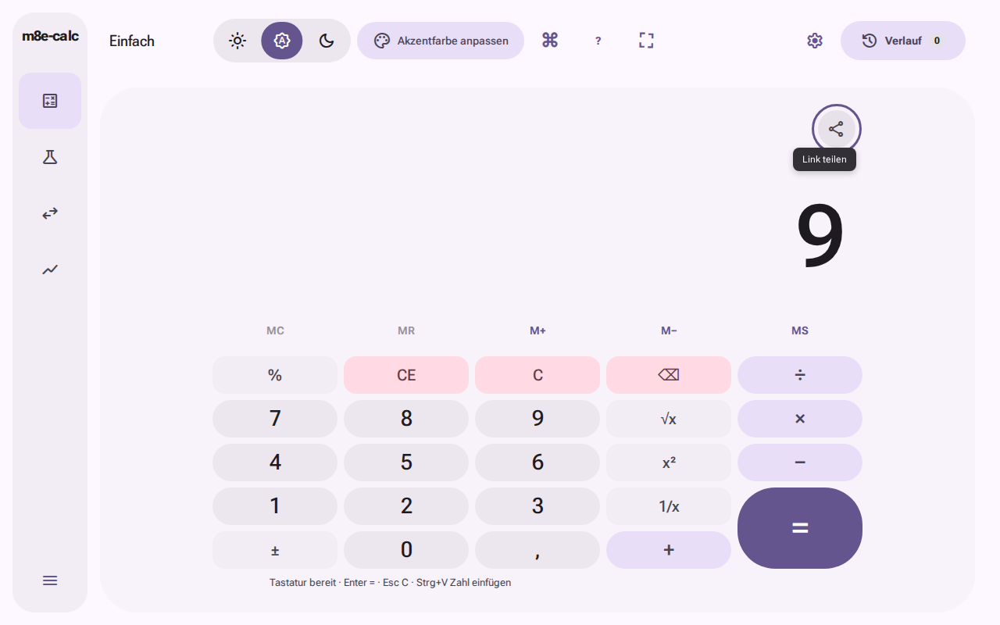
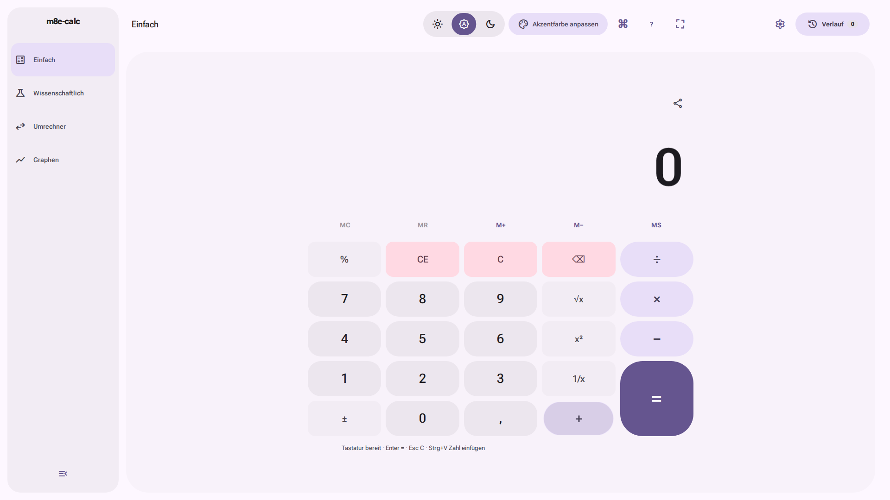
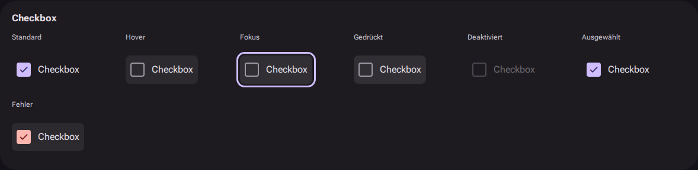

# AP25 · Produktabnahme

Historischer Paketnachweis vom 17.10.2026. Aktueller Produktkandidat,
Pages-SHA und offene AP39-Abnahme: [AP38](AP38.md). Die folgenden Messungen,
Bilder und damaligen Zugriffssperren behalten ihren ursprünglichen Bezug.

Stand: 17.10.2026 (Europe/Berlin). PR: [#40](https://github.com/sl3ndrr/m8e-calc/pull/40),
Branch `feat/ap25-product-acceptance`, gestartet von aktuellem `main`
`de6b502b8f49e9f3d44064460e56f19f2f3682fc`.

**Abnahmegrenze:** Die automatisierte Abnahme prüft den Produktionsbuild des
unten bezeichneten PR-Codes. Die interaktive Pages-Abnahme ist wegen blockiertem
Live-Zugriff weiterhin **nicht ausführbar**. Keine pauschale Produktionsfreigabe,
kein Merge, Tag, Release oder Deployment aus dieser Abnahme.

## Letzter Befund und enge Produktkorrektur

Der Dokumentationscommit `1cdffa6936e6baca3edd6bb7cd6cbb96a2956313`
änderte keinen Produktcode. Dennoch scheiterte sein [CI-Lauf 39012581208](https://github.com/sl3ndrr/m8e-calc/actions/runs/39012581208/job/117338053059)
im bestehenden wissenschaftlichen Fehler-/History-Fall: `1/0` auswerten, danach
Escape; erwartet leerer Editor, tatsächlich weiterhin `1/0`. `npm run check`
bestand (2086 Tests); Chromium meldete 142 bestanden / 1 fehlgeschlagen,
der abhängige Graph-Performance-Fall lief nicht, der nachfolgende Galerie-Schritt
wurde nicht ausgeführt. Artefakt `12093264038`,
`test-results/app/scientific-DEG-definitions-48358-eyboard-history-and-restore-chromium/trace.zip`.
Alle Hardening-QA-Gates desselben Heads bestanden; das widerlegt den einzelnen
Fehler nicht und macht ihn nicht nachträglich grün.

Der gemeinsame CodeMirror-Adapter ließ seine Standard-Completion-Tasten mit
höherer Priorität vor den Rechneraktionen laufen. Ein aktiver oder ausstehender
Vorschlag konnte Escape zum bloßen Schließen und Enter zum Übernehmen verwenden,
obwohl die dokumentierten Aktionen Leeren bzw. Auswerten lauten. Der Fehler war
zuvor nicht deterministisch abgedeckt. Zwei neue Adapterregressionen öffnen
Vorschläge gezielt und prüfen beide Rechneraktionen; der vorhandene Browserfall
prüft zusätzlich Escape bei sichtbarer Completion und danach weiterhin Tab.

Der ausschließlich ergänzte Regressionstest-Commit
`d372a4740515e7bb120a5e9eb177f3bebb1e816f` belegt das Verhalten vor der Reparatur:
[CI 39013181722, Job 117339833471](https://github.com/sl3ndrr/m8e-calc/actions/runs/39013181722/job/117339833471),
**2086 bestanden, genau die zwei neuen Escape-/Enter-Fälle fehlgeschlagen**.
Die Tests scheitern an den fehlenden Rechner-Callbacks, nicht an Setup oder Timing.
[Original-Tracebild des Escape-Fehlers](screenshots/ap25/scientific-escape-failure-chromium.jpeg)
aus dem früheren fehlgeschlagenen Browserlauf; im Bild bleibt `1/0` mit
Divisionsfehler stehen, obwohl Escape bereits gedrückt wurde.

Enge Korrektur dieses PR: Standard-Completion-Keymap ausdrücklich unter den
vorhandenen Rechneraktionen installieren. Vorschlagsnavigation und Strg+Leertaste
bleiben über dieselben CodeMirror-Kommandos erhalten. Keine Engine-, Format-,
Währungs-, Layout- oder Budgetänderung. Die unten dauerhaft gesicherten Bilder
entstanden **vor** dieser Tastaturkorrektur und werden nicht als neue Belege
umetikettiert. Der genaue Abschluss-SHA und die abgeschlossenen Prüfläufe dieser
Korrektur stehen im [Testabschnitt von PR #40](https://github.com/sl3ndrr/m8e-calc/pull/40).

## Historische Integration und Veröffentlichung am 17.10.2026

Ein Roadmap-Haken bedeutet Merge. Eigentümerentscheidungen zu MIT, Release und
Tag sowie manuelle/physische Freigaben bleiben davon unabhängig.

| Paket                     | Integrierter PR                                    | Merge-SHA                                  |
| ------------------------- | -------------------------------------------------- | ------------------------------------------ |
| AP16 Releasevorbereitung  | [#21](https://github.com/sl3ndrr/m8e-calc/pull/21) | `4350251b6c4e4a9b7b66c943f03f5f301bbc2ec7` |
| AP17 Währungen            | [#23](https://github.com/sl3ndrr/m8e-calc/pull/23) | `f48afe1e0bdb5baf42eb1ec194883ecdc1c41e87` |
| AP18 Shell/Teilen         | [#25](https://github.com/sl3ndrr/m8e-calc/pull/25) | `d5709aca97a0d4d72317aac32de4213dcf063b8b` |
| AP19 Ziffern/Tasten       | [#26](https://github.com/sl3ndrr/m8e-calc/pull/26) | `54455e4022a322d0bff845dce00fcfe4f635c98f` |
| AP20 Checkbox/Theme       | [#27](https://github.com/sl3ndrr/m8e-calc/pull/27) | `7446ae354ccbd8fe79d7e53676a1c354067f796b` |
| AP21 Fit                  | [#24](https://github.com/sl3ndrr/m8e-calc/pull/24) | `bdc75289d3f6f9ffca8b2f01b204cf32effe3f0a` |
| AP22 Graphzahlen/Tabellen | [#28](https://github.com/sl3ndrr/m8e-calc/pull/28) | `940d147ed3ec103887775c18e99f4155a84bab38` |
| AP23 Internes Lab         | [#29](https://github.com/sl3ndrr/m8e-calc/pull/29) | `cb844ec1faa35de9a540876c3be195641cef7f4f` |
| AP24 Dependencies         | [#30](https://github.com/sl3ndrr/m8e-calc/pull/30) | `de6b502b8f49e9f3d44064460e56f19f2f3682fc` |

Die PR-Inhalte und GitHub-Vergleiche jedes Merge-SHA mit dem Ausgangs-main wurden
geprüft: jeweils `behind_by=0`, AP24 identisch. Es fehlt keine dieser Integrationen.
Die früheren gegenteiligen Roadmap-Aussagen wurden berichtigt.

Der [Pages-Lauf 38622365643, Versuch 2](https://github.com/sl3ndrr/m8e-calc/actions/runs/38622365643/attempts/2)
veröffentlichte `f48afe1e…` am 15.10.2026 erfolgreich (Deployende 10:40:24 UTC).
Er enthält AP16/AP17 und Hardening, liegt aber vor AP18–AP24.

Der neuere [Pages-Lauf 38974943704](https://github.com/sl3ndrr/m8e-calc/actions/runs/38974943704)
ist ebenfalls erfolgreich: Build-Job `117222006025`,
[Deploy-Job 117224621707](https://github.com/sl3ndrr/m8e-calc/actions/runs/38974943704/job/117224621707).
Original-Deploylog: `pages_build_version` und Deployment-ID exakt
`de6b502b8f49e9f3d44064460e56f19f2f3682fc`, Erfolg **16.10.2026 22:26:27 UTC**,
Jobende 22:26:29 UTC. Damit bestätigt Pages ein Artefakt mit AP18–AP24.
Ob genau diese Bytes/Ansichten aktuell an den Live-Browser ausgeliefert werden,
ist wegen `net::ERR_BLOCKED_BY_CLIENT` beim konkreten Aufruf von
https://sl3ndrr.github.io/m8e-calc/ hier nicht überprüfbar. Die erfolgreiche
Veröffentlichung ist kein Beweis vollständiger UI-Abnahme.

[Issue #22 wurde erneut gelesen und aktualisiert](https://github.com/sl3ndrr/m8e-calc/issues/22#issuecomment-6226233441).
Es bleibt wegen der ausstehenden Live-Abnahme offen. Die Ursache des damaligen
Timeouts nach #20 bleibt ausdrücklich ungeklärt.

## Prüfstrategie und Ergänzungen

Bestehende gute Pakettests werden weiterverwendet. Firefox/WebKit führen nun
zusätzlich die vorhandenen AP18-, AP19-, Graph-/Tabellen-, Rechner-, Umrechner-,
Verlaufs-, Permalink- und Währungsregressionen aus. Die Galerie führt ihre
bestehenden Checkbox-/Theme-Zustandsprüfungen zusätzlich in Firefox/WebKit aus.
Keine Snapshot-Baseline, Pixeltoleranz, Timeout- oder Performancegrenze wurde erhöht.
Ausgeschriebene Operatornamen verhindern kollidierende Playwright-Artefaktpfade
für `+`, `*` und `/`; Prüfabläufe und Assertions bleiben dabei identisch.

| Kritischer Fall                                  | Nachweis                                                                                                                                                                                                                                                  |
| ------------------------------------------------ | --------------------------------------------------------------------------------------------------------------------------------------------------------------------------------------------------------------------------------------------------------- |
| „9“, lange Zahlen, Exponenten, de/en             | Bestehender AP19-Ink-Oracle mit/ohne Zeichenmaske, echten Schriftpixeln und Clipgeometrie; portable Screenshotaufnahme für Firefox/WebKit                                                                                                                 |
| Operatoren drücken/loslassen, aktive Form, Fokus | Bestehende rAF-/Bewegungsassertions, jetzt ein eigenständiger Test je Operator; Pointer, globale Tastatur und fokussierte Space-Aktion, unveränderte Radien/Maße und nicht konstante Full-Bewegung                                                        |
| Checkboxzustände/Systemtheme ohne Zusatzicon     | Bestehende Galerieprüfung: selected/unselected/mixed/invalid/disabled, Hover/Press/Fokus, Full/Reduced/Off und OS-Reduktion, drei Hauptsymbole und Live-Systemstatus                                                                                      |
| Share-Icon erzeugt Permalink                     | Bestehende AP18-Tab-/Enter-/Tooltip-/48px-Prüfung plus bestehende Roundtrips aller vier Modi; Währungen ausgeschlossen                                                                                                                                    |
| Wiederholtes Fit mit Aspektsperre                | Bestehende AP21-Regressionssuite einschließlich schneller Klicks, Basis, History/Permalink, Resize und Extremwerten                                                                                                                                       |
| Lokalisierte gerundete Tabellen                  | Bestehende AP22-de/en- und Separator-/Gruppierungsprüfungen, bestätigte Schrittweite, Rundung nur Anzeige, 500-Zeilen-Limit                                                                                                                               |
| PWA-Update/offline                               | Neue echte Browser-SW-Lebenszyklusprüfung: vorherige Cache-Identität desselben generierten Produktionsworkers, wartender neuer Worker, UI-Angebot, Aktivierung/Reload, Cachebereinigung, anschließend vier Modi jeweils offline mit Reload und Berechnung |
| Kein neues Netzwerkverhalten                     | Bestehende Currency-Opt-in-Mocks plus keine externen Requests in neuer Desktop-/PWA-Matrix. Die App lädt Build-Info nicht; normale Artefakte/Precache enthalten kein Lab                                                                                  |

Der PWA-Test simuliert ausdrücklich eine vorherige Worker-/Cache-Revision mit
identischen Produktassets. Er belegt den echten Waiting-/Activation-/Offline-Pfad,
keine Migration einer behaupteten historischen Veröffentlichung. Die vorhandene
Kaltstart-Offline-Prüfung bleibt zusätzlich erhalten. Chromium prüft reale
Text-/PNG-Zwischenablage und Installierbarkeit. Firefox/WebKit nutzen beim
Textkopiervertrag einen ausdrücklich gekennzeichneten In-Memory-Adapter;
zwei OS-Paste-Fälle je Browser sind dort übersprungen, PNG-OS-Copy bleibt Chromium.

Neue integrierte, paarweise Matrix (CSS-Pixel; Desktop-Safari-Projekt mit DPR 2): in jeder Zeile **alle vier Modi**, echte
Tab-/Shift+Tab-Fokusprüfung, Share-Ziel im Viewport und kein horizontaler
Dokumentüberlauf. Repräsentative Akzente Iris/Teal/Coral:

| Desktop   | Sprache | Theme (System) | Akzent | Bewegung |
| --------- | ------- | -------------- | ------ | -------- |
| 1280×800  | de      | Hell           | Iris   | Full     |
| 1280×800  | en      | Dunkel         | Teal   | Reduced  |
| 1920×1080 | de      | Dunkel         | Coral  | Off      |
| 1920×1080 | en      | Hell           | Iris   | Full     |
| 3840×2160 | de      | Hell           | Teal   | Reduced  |
| 3840×2160 | en      | Dunkel         | Coral  | Off      |

Dies ist keine Behauptung aller kartesischen Kombinationen. Dazu kommen die
bestehenden 24 visuellen Vergleiche (de, drei Desktopgrößen, Hell/Dunkel,
Motion-off), 960×540-Reflow aller Modi und nativer Chromium-Tabzoom
100/125/150/200% für Ziffern sowie Galerie-/Graphcheckboxen. DPR oder CSS-Reflow
werden nicht als echter Browserzoom ausgegeben. Kein mobiles Komplettredesign.

## Ergebnisse und Umgebung

Vollständig grüner Prüfstand vor dem zuletzt gefundenen Editorfehler: `0f2b3b3cfe224bf35b87c22ff9ea25155559958e`.
Synthetischer PR-Merge-/Build-SHA: `d8b996265dd06cecfc488fee6db483f16b9e0509`.
Dauerhafte Bild-/Rohmessbelege stammen vom vorangehenden `bb5096de…` und sind
unten ausdrücklich diesem Stand zugeordnet. Dazwischen änderten sich nur die
Testbereitschaft der Autovervollständigung und die Galerie-Browserprofile;
der Produktcode blieb identisch.
CI prüft den synthetischen PR-Merge-SHA; `environment.json` und `build-info.json`
benennen ihn getrennt vom Branch-Head. Ubuntu 24.04, Node 24.21.0, npm 11.19.0/Lockfile,
Playwright 1.64.0, Chromium 156.0.8078.4, Firefox 157.0 und WebKit 27.2; genaue Node-/Browser-/Image-Versionen in den Artefakten.

| Vorheriger grüner Lauf auf `0f2b3b3…`                                                                                                                                                       | Ergebnis                                                                                                                                                              |
| ------------------------------------------------------------------------------------------------------------------------------------------------------------------------------------------- | --------------------------------------------------------------------------------------------------------------------------------------------------------------------- |
| [AP25 39011871350](https://github.com/sl3ndrr/m8e-calc/actions/runs/39011871350/job/117335935502)                                                                                           | **Bestanden:** `npm run check` einschließlich 2086 Tests sowie 33/33 integrierte Browser-/PWA-Fälle; Artefakt `12093093486` mit exaktem Build-SHA/Umgebung            |
| [QA Chromium](https://github.com/sl3ndrr/m8e-calc/actions/runs/39011871366/job/117335935425)                                                                                                | **Bestanden:** 143/143                                                                                                                                                |
| [QA Firefox](https://github.com/sl3ndrr/m8e-calc/actions/runs/39011871366/job/117335935408)                                                                                                 | **Bestanden mit Grenze:** 117 bestanden, 2 OS-Paste-Skips                                                                                                             |
| [QA WebKit](https://github.com/sl3ndrr/m8e-calc/actions/runs/39011871366/job/117335935331)                                                                                                  | **Bestanden mit Grenze:** 117 bestanden, 2 OS-Paste-Skips; Tab-Vervollständigung jetzt ebenfalls bestanden                                                            |
| [Visuelle QA](https://github.com/sl3ndrr/m8e-calc/actions/runs/39011871366/job/117335935438)                                                                                                | **Bestanden:** 24/24, keine Referenzänderung                                                                                                                          |
| [Runtime](https://github.com/sl3ndrr/m8e-calc/actions/runs/39011871366/job/117335935406) / [Messung nachher](https://github.com/sl3ndrr/m8e-calc/actions/runs/39011871366/job/117335935372) | **Bestanden:** Runtime-, Bundle-, Kontrast-, Audit- und Lighthouse-Gates                                                                                              |
| [AP22 39011871369](https://github.com/sl3ndrr/m8e-calc/actions/runs/39011871369) / [Release-Assets 39011871378](https://github.com/sl3ndrr/m8e-calc/actions/runs/39011871378)               | **Bestanden**                                                                                                                                                         |
| [CI 39011871380](https://github.com/sl3ndrr/m8e-calc/actions/runs/39011871380/job/117335935246)                                                                                             | **Bestanden:** vollständiges `npm run check`, 144 Chromium-/Graph-Performance-Fälle und 37 Galerie-Fälle einschließlich der jeweiligen Firefox-/WebKit-Desktopprofile |

Der anschließende Dokumentationslauf deckte den oben beschriebenen Editorfehler auf.
Die früheren grünen Läufe und Rohmessungen bleiben exakt ihren SHAs zugeordnet;
aktuelle Abschlussläufe stehen separat in PR #40. Keine Prüfung wird rückwirkend
als Live-Abnahme ausgegeben.

Der vorangehende vollständige Messstand ist `bb5096de…`, Build-/Merge-SHA
`cc627a1bfc1d98b1698e11cde13621cc233adfeb`. Die WebKit-Abweichung bleibt
hier ausdrücklich fehlgeschlagen; die gezielte Synchronisationskorrektur steht
im anschließenden Code-Prüfstand.

| Gate / konkreter Lauf                                                                                       | Ergebnis                 | Beleg / Messwert                                                                                                                                              |
| ----------------------------------------------------------------------------------------------------------- | ------------------------ | ------------------------------------------------------------------------------------------------------------------------------------------------------------- |
| [CI 38980823748](https://github.com/sl3ndrr/m8e-calc/actions/runs/38980823748/job/117241149662)             | **Bestanden**            | `npm run check`: 64 Dateien / 2086 Tests, Lint, Typen, Build, Engine-/Graph-Benchmarks; 144 Chromium-Fälle einschließlich Graph-Performance; 37 Galerie-Fälle |
| [AP25 38980823580](https://github.com/sl3ndrr/m8e-calc/actions/runs/38980823580)                            | **Bestanden**            | 33/33, drei Browser: Matrix, Build-Nachweis und vier PWA-Startmodi; Artefakt `12080913735`                                                                    |
| [QA Chromium](https://github.com/sl3ndrr/m8e-calc/actions/runs/38980823552/job/117241034775)                | **Bestanden**            | 143/143; Artefakt `12080473862`                                                                                                                               |
| [QA Firefox](https://github.com/sl3ndrr/m8e-calc/actions/runs/38980823552/job/117241034725)                 | **Bestanden mit Grenze** | 117 bestanden, 2 OS-Paste-Fälle übersprungen; Artefakt `12080314317`                                                                                          |
| [QA WebKit](https://github.com/sl3ndrr/m8e-calc/actions/runs/38980823552/job/117241034845)                  | **Fehlgeschlagen**       | 116 bestanden, 1 Autovervollständigungsfall fehlgeschlagen, 2 OS-Paste-Skips; Trace im Artefakt `12080853919`, Details unten                                  |
| [Visuelle QA](https://github.com/sl3ndrr/m8e-calc/actions/runs/38980823552/job/117241034765)                | **Bestanden**            | 24/24 gegen unveränderte Referenzen; Artefakt `12080573134`                                                                                                   |
| [Messung nachher](https://github.com/sl3ndrr/m8e-calc/actions/runs/38980823552/job/117241034490)            | **Bestanden**            | 197421/200000 Byte Start-JS gzip; 384 Farbschemata / 36480 Kontrastprüfungen, Minima Text 4,577:1 / UI 3,035:1; Audit 0 Schwachstellen                        |
| Lighthouse, derselbe Messlauf                                                                               | **Bestanden**            | Je 3 Läufe; Performance-Median und -Minimum Einfach 99, Wissenschaftlich 98, Umrechner 99, Graphen 99; Accessibility/Best Practices überall 100; CLS 0        |
| [Runtime](https://github.com/sl3ndrr/m8e-calc/actions/runs/38980823552/job/117241034824)                    | **Bestanden**            | Editor max. 56 ms, Heap +703804 Byte nach 20 Zyklen, Listener +0, CLS 0; Nodes 417→417, rAF 0→0, Observer 1→1                                                 |
| Graph-Performance, CI oben                                                                                  | **Bestanden**            | 3840×2160, 6 Kurven, Render-P95 0,60 ms, beobachtete rAF 59,21 FPS, Sampling-Worker 13,5 ms; Headless-Messung                                                 |
| [AP22 38980823645](https://github.com/sl3ndrr/m8e-calc/actions/runs/38980823645/job/117241034664)           | **Bestanden**            | 13 gezielte Graph-/Tabellenfälle                                                                                                                              |
| [Release-Assets 38980823583](https://github.com/sl3ndrr/m8e-calc/actions/runs/38980823583/job/117241034356) | **Bestanden**            | 9 reale Releasebilder, 23 Markdown-Dateien / 54 externe URLs; frühere IAU-400 siehe unten                                                                     |
| Pages interaktiv, veröffentlichtes `de6b502…`                                                               | **Nicht ausführbar**     | Browserzugriff blockiert; Deploy-SHA bestätigt Integration, keine Live-UI-Abnahme                                                                             |

Dauerhafte kompakte Rohwerte: [Messnachweis](screenshots/ap25/validation.json).
Die alte Vorher-Messung im QA-Workflow verwendet weiterhin den ausdrücklich
fixierten AP15-Ausgangsstand `67d9c968…`; sie wird nicht als direkte AP24-vs.-AP25-
Produktdifferenz ausgegeben.

Lokal: Node 24.19.0/npm 11.9.0. `npm ci` scheiterte mit HTTP 403 beim Download
von `zustand-5.0.15.tgz`; `npm run check` endete mit `eslint: not found`.
Das sind **nicht ausführbare lokale Gates**, keine bestandenen Releasechecks.
Der Formatcheck wurde mit dem exakt gelockten Prettier 3.9.10 aus dem PR-CI-
Artefakt erfolgreich wiederholt; keine fremden Dependencies als vollständige
Installation ausgegeben.

## Tatsächliche Abweichungen und Korrekturen

[Erster QA-Lauf 38975768612](https://github.com/sl3ndrr/m8e-calc/actions/runs/38975768612),
Code `f764658a7e4139103392047916f757268d931b07`: **353 bestanden, 13 fehlgeschlagen,
4 übersprungen**. Visuell/Bundle/Kontraste/Lighthouse bestanden. Der initiale
Gesamtcheck scheiterte an Formatierung; mit gelocktem Formatter korrigiert.
Fehlertraces und echte Zwischenbilder: Artefakt `qa-browsers` desselben Laufs
(ID `12079447374`). Die bestätigten Korrekturen betreffen Testanbindung und Belege:

| Reproduktion                                                                                    | Erwartet / tatsächlich im ersten Lauf                                                                | Enge Korrektur                                                                             |
| ----------------------------------------------------------------------------------------------- | ---------------------------------------------------------------------------------------------------- | ------------------------------------------------------------------------------------------ |
| Neuer Matrixtest, wissenschaftlicher Editor, danach vorwärts Tab zum Share-Icon, Firefox/WebKit | Share wird per Tastatur erreicht / der Vorwärtspfad ab Editor erreichte Share nach 180 Tabs nicht    | Bestehenden rückwärtigen Shift+Tab-Pfad verwenden, Fokusassertion beibehalten              |
| Alle fünf umfangreichen Operator-Framefolgen in einem WebKit-Test                               | Vollständige Messung im Standardlimit / Gesamtfolge überschritt 30 s                                 | Eigenständiger Fall je Operator, dieselben Frames/Assertions und dasselbe Zeitlimit        |
| WebKit-Währungsrequests mit Page-Routenmock und aktivem SW, dann explizites Opt-in              | Mockkurs 1,25 und steuerbare Loading-Phase / realer HTTP-200-Kurs (112,53 statt 125) umging den Mock | SW im Netzwerk-Mocktest blockieren; echte SW-Abnahme separat. Kein Produkt-Opt-in geändert |
| Wissenschaftlich 1/0 während Update-Angebot                                                     | Divisionsfehler prüfen / globales `role=alert` passte zugleich auf gültiges Update-Angebot           | Lokalen `.scientific-error[role=alert]` prüfen; PWA-Angebot bleibt erhalten                |

Ein zusätzlicher AP25-Befund wurde direkt behoben: Im ersten Build-Nachweis
lag `build-info.json` in den SW-Precache-URLs (reproduzierbar in
`cache-revisions.json` des Laufs 38978575368). Erwartet war ein rein passiver
Direktabruf. Das Build-Info-Plugin läuft deshalb nach dem PWA-Plugin; die neue
PWA-Regression verlangt ausdrücklich, dass keine Build-Info precached wird.
Diese Korrektur ändert keine sichtbare UI und keine Währungsrequests.

Alle 24 QA-Bildreferenzen und drei WOFF2-Dateien wurden zusätzlich per Git-Blob-
Hash mit Main verglichen: bytegleich. Keine bestätigte neue Produktabweichung
wird durch Baseline-Updates verdeckt.
Im Folgelauf `38978575367` auf `94967f2` bestanden Chromium (143) und
Firefox (117, zwei OS-Paste-Skips). WebKit bestand 116 Fälle bei zwei Skips;
ein AP18-Toastfall scheiterte: Ein echtes „Neue Version verfügbar“-Angebot war
laut Trace bereits sichtbar und hielt die FIFO-Snackbar belegt, sodass „Link
kopiert“ dahinter wartete. Die AP18-Clipboard-/Fokusprüfung blockiert deshalb
nun den SW; die separate PWA-Suite prüft das Update-Angebot weiterhin real.
Beleg: `qa-browsers-webkit`, Artefakt-ID `12080885394`,
`ap18-ui-mode-headings-shar-f2889-pboard-feedback-de-convert--webkit/trace.zip`.
Kein Überschreiben wichtiger Produktbenachrichtigungen zur Testberuhigung.
Im nächsten WebKit-Lauf auf `855f902` blockierte derselbe Toast eine Hover-Aktion
im Full→Reduced→Off-Test (Log: Interception durch Snackbar, keine fehlgeschlagene
Shape-Assertion). Feature-/Controls-Zustandsprüfungen verwenden deshalb nun
konsistent einen blockierten SW. Die integrierte Produktmatrix, Comfort-Offline-
und Update-Suiten behalten echte Worker. WebKit meldet im Lauf außerdem einen
Fallback auf seine Default-Session; das ist eine Grenze dieser Headless-Umgebung,
keine behauptete Safari-/Produktursache.

Im Messstand `bb5096de…` scheiterte die wissenschaftliche Tab-Vervollständigung
in WebKit: `inte` eingeben, Strg+Leertaste, Tab; erwartet `integral(`, tatsächlich
`inte`. Der Trace zeigt unmittelbar vor Tab eine
`.cm-tooltip-autocomplete-disabled` außerhalb des sichtbaren Bereichs
(`top: -10000px`). Der bisherige Test prüfte nur deren erhaltenen Text. Die
Korrektur wartet auf die sichtbare, nicht deaktivierte Vorschlagsliste; die
Übernahme und das unveränderte Standardlimit werden weiterhin geprüft.
Beleg: [Job 117241034845](https://github.com/sl3ndrr/m8e-calc/actions/runs/38980823552/job/117241034845),
Artefakt `12080853919`,
`scientific-insertion-wraps-f9a91-etion-and-single-line-paste-webkit/trace.zip`.
Kein Produktcode, Retry oder Timeout wird dafür verändert.
Die Galerieprojekte erhalten außerdem die jeweiligen Desktop-Firefox-/Safari-
Profile statt des zuvor geerbten Chromium-Profils.

Die alten gescheiterten bzw. durch Folgecommits abgebrochenen Läufe bleiben
historische Belege und werden nicht als grün umgedeutet.

Zusätzlicher externer Befund: Im [Release-Assets-Lauf 38979932572](https://github.com/sl3ndrr/m8e-calc/actions/runs/38979932572/job/117238155787)
waren Build und neun Releasebilder erfolgreich. Die externe Linkprüfung
scheiterte an HTTP 400 für die beiden bestehenden IAU-Archivseiten
`https://iauarchive.eso.org/administration/resolutions/general_assemblies/` und
`https://iauarchive.eso.org/public/themes/measuring/`. Das ist kein Rechnerfehler
und kein Beweis, dass die Quellen verschwunden sind; sie waren über die
unabhängige Web-Recherche weiterhin lesbar. Keine neue Checker-Ausnahme oder
Timeout-Erhöhung. Im späteren Lauf [38980823583](https://github.com/sl3ndrr/m8e-calc/actions/runs/38980823583/job/117241034356)
bestand derselbe unveränderte Checker einschließlich dieser URLs. Der frühere
Fehler bleibt als zeitweiser Befund erhalten; keine permanente Quellenänderung
wird daraus abgeleitet.

## Bilder und Rohbelege

Alle folgenden Originaldateien stammen aus dem Code-Messstand `bb5096de…`;
Build-SHA `cc627a1…`. [Provenienz mit Pfaden, Prüfsummen und PNG-Maßen](screenshots/ap25/provenance.json).
Die Aufnahmen wurden visuell geprüft und unverändert übernommen. Die Galerieaufnahme
ist ausdrücklich ein separates Testziel, kein Bestandteil des normalen Artefakts.

| Aufnahme                                                                  | Browser / Zustand                                                          |
| ------------------------------------------------------------------------- | -------------------------------------------------------------------------- |
| [Einfach: 9 und Share-Fokus](screenshots/ap25/simple-9-1280-chromium.png) | Chromium, 1280×800 CSS, de/Hell/Full                                       |
| [Wissenschaftlich](screenshots/ap25/scientific-en-1280-webkit.png)        | WebKit, 1280×800 CSS / DPR 2, en/Dunkel/Reduced                            |
| [Umrechnung](screenshots/ap25/convert-1920-chromium.png)                  | Chromium, 1920×1080 CSS, en/Hell/Full                                      |
| [Graph mit Checkboxen](screenshots/ap25/graph-dark-1920-firefox.png)      | Firefox, 1920×1080 CSS, de/Dunkel/Off                                      |
| [Updateangebot](screenshots/ap25/pwa-update-webkit.png)                   | WebKit, echte kontrollierte Workerrevision, DPR 2                          |
| [Plus gedrückt](screenshots/ap25/operator-plus-pressed-chromium.png)      | Chromium, echte CSS-Transition am Mittelpunkt pausiert, danach fortgesetzt |
| [Checkboxzustände](screenshots/ap25/checkbox-dark-chromium.png)           | Chromium-Galerie, Dunkel, ausgewählt/unselektiert/Fokus/disabled/invalid   |







Zusätzlich dauerhaft: [echte Press-/Release-rAF-Samples der Plustaste](screenshots/ap25/operator-plus-live-frames.json).
Die übrigen Operatoren und vollständigen Matrix-/Offline-Aufnahmen stehen in
den konkret verlinkten Actions-Artefakten.

Die Screenshots stammen aus tatsächlich ausgeführten Headless-Browsern gegen
den CI-Preview des Produktionsbuilds, nicht von der gesperrten Pages-Seite.
Bewegung wird zusätzlich mit echten rAF-Samples geprüft; deaktivierte
Screenshotanimationen allein sind kein Press-/Release-Nachweis. Actions-Artefakte
bleiben 7 bzw. 14 Tage verfügbar; ausgewählte PNGs werden dauerhaft im PR gesichert.

## Offen / Folgearbeit

- **Historisch nicht ausführbar:** Live-Abnahme des damaligen `de6b502…`.
  AP25 ist inzwischen durch #40 integriert. #22 bleibt offen; AP39 übernimmt
  die Live-Abnahme des Kandidaten aus [AP38](AP38.md), nach tatsächlichem
  Pages-/Build-Info-Abgleich. Die damalige Zugriffssperre ist kein neuer Live-Test.
- **Eigentümer:** MIT-/Copyright-Bestätigung, Releasefreigabe und Tag unverändert
  offen. Kein tatsächliches GitHub Release aus Versionsnummer oder AP16-Merge ableiten.
- Der ursprüngliche Vorwärts-Tab-Pfad ab wissenschaftlichem Editor erreichte
  Share in Firefox/WebKit nicht innerhalb der 180 Testschritte. Der geprüfte
  kurze Shift+Tab-Pfad belegt Erreichbarkeit, keine vollständige Vorwärts-
  Fokusreihenfolge. Diese längere Navigation gezielt manuell nachprüfen;
  Ursache/Einordnung nicht aus dem Grenzwert ableiten.
- Physischer Screenreader, hörbare Ausgabe, reale Monitor-/GPU-Nutzung und
  Langzeitsitzungen sind durch Headless-/Laborwerte nicht abgenommen.
- Implizite Konturen sind inzwischen in AP26/AP27 integriert (#17 geschlossen).
  Bestehende Folgearbeit bleibt abgegrenzt:
  Währungs-Snapshots für Verlauf/Permalinks, Dependency-Majors gemäß AP24,
  Font-Neugenerierung nur nach eigenem visuellen Review. Kein neuer Produktumfang.

## Reproduktion

```sh
npm ci
npm run check
npx playwright install --with-deps chromium firefox webkit
npx playwright test --project=chromium --project=firefox --project=webkit --project=qa-performance
npx playwright test --project=chromium-graph-performance
npx playwright test --project=qa-visual
npm run build:gallery
npm run test:e2e:gallery
node scripts/qa-bundle.mjs
node scripts/qa-contrast.mjs
npm audit
npx --yes --package @lhci/cli@0.15.1 lhci autorun
node scripts/qa-lighthouse.mjs
node scripts/check-release-docs.mjs
```

CI-/QA-Gates überlappen sich bewusst; ihre Testzahlen werden nicht zu einer
künstlich höheren Zahl unabhängiger Tests addiert. Keine automatische
Referenzübernahme und kein pauschales Erhöhen von Budgets/Timeouts.
