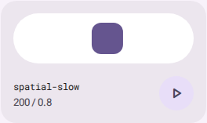
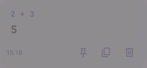
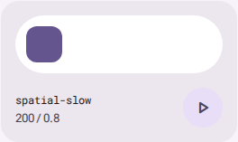
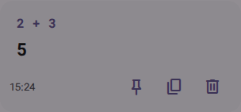

# AP36 · Eigenständige Motion-14-Migration

Aktueller Integrationsstand vom 20.10.2026: #61 ist seit 19.10. auf main
`118650984ccbb881339b8a4f4ad0e503458a17a2` integriert; Motion 14.4.0 ist
Bestand, #35 geschlossen. Die grüne PR-Abnahme ist kein grüner main-/Pages-
Nachweis: aktuelle Quellenblockade und letzter Deploy stehen in [AP40](AP40.md).
Die folgenden Messungen behalten ihre jeweiligen historischen SHAs.

Basis: main `964f6b4e7d605d7b2e73248c1ed9ac3e32fe2839`, Branch
`feat/ap36-motion14`, [PR #61](https://github.com/sl3ndrr/m8e-calc/pull/61).
AP28 (#44), AP30 (#46), AP33 (#49), AP34 (#59) und AP35 (#60) sind integriert.
[AP33](AP33.md) dokumentiert die fortgeschriebene Wartungsentscheidung.
Kein Merge, Release, Tag oder Deployment durch AP36.

## Version, Breaking Changes und tatsächliche Imports

Ziel ist **Motion 14.4.0**, Manifest `^14.4.0`, stabil veröffentlicht am
18.10.2026. Offizielle Registry-Abfrage am 19.10.2026, 13:37:40 UTC und reguläre
Lockfile-Erzeugung mit Node 24/npm 11.19.0:
[Vorbereitung 39261703943](https://github.com/sl3ndrr/m8e-calc/actions/runs/39261703943).
Danach frisches `npm ci --engine-strict` und erfolgreiches `npm run check`.
Kein Override, manueller Integrity-Eingriff oder konstruierter Lockfile.

Gelesene Primärquellen: [React-Upgradeguide](https://motion.dev/docs/react-upgrade-guide),
[JavaScript-Upgradeguide](https://motion.dev/docs/upgrade-guide) und
[offizieller Changelog](https://github.com/motiondivision/motion/blob/main/CHANGELOG.md).

- **13.0 / Prop-Filtering:** Die optionale automatische Emotion-Propvalidierung
  entfällt. Betroffene Styled-/Emotion-Kompositionen müssten `MotionConfig` / `isValidProp` injizieren oder ihr Prop-Forwarding regeln. Der vollständige
  App-Importscan findet kein `motion/react`, `framer-motion`, Motion-JSX,
  Styled Components oder Emotion. Deshalb kein neues Filterpaket erforderlich.
- **13/14 / Vanilla:** Laut Upgradeguide keine öffentlichen Vanilla-Breaking-Changes.
  Die beiden Aufrufstellen verwenden öffentliche `animate`-Signaturen und Controls.
- **14.0 / Interna:** Der Changelog entfernt interne Kompatibilitäts-APIs aus
  13.5.1, darunter `observeTimeline`, und pinnt interne Abhängigkeiten. Keine
  internen Imports oder Timeline-/Scroll-API im App-Code. Frisches npm ci und
  `npm ls --all` bestätigen eine konsistente Auflösung.
- **14.2–14.4:** Beschleunigte unabhängige Transformwerte; 14.3.1 behebt unter
  anderem Transformreste und Cleanup geteilter Elemente. Deshalb echte Frames
  und Unterbrechungen prüfen. Vanilla-Drag aus 14.4.0 wird nicht verwendet.

Genau ein Lockfile-Knoten je `motion` **14.4.0**, `framer-motion` **14.4.0**,
`motion-dom` **14.4.0** und `motion-utils` **14.1.1**. Exakte interne Bindungen,
keine inkompatiblen Zweitauflösungen. React-Peer `^18.0.0 || ^19.0.0` akzeptiert
unverändertes React 19.2.0. Nur diese vier Paketknoten und der Root-Vertrag
ändern sich. Keine gleichzeitige Migration von React, jsdom, Vitest, ESLint,
TypeScript, Farb- oder Fontpaketen. Paketbaum und Buildgraph stehen in den
[Rohmessungen](ap36/measurements.ndjson).

Tatsächliche Aufrufstellen:

- `src/app/HistorySheet.tsx`: Vanilla `animate`; Full mit opacity/y/scale und
  Spatial-Fast, Reduced/OS nur opacity mit Effects-Fast; Einstellung und Unmount.
- `src/ui/MotionDemo.tsx`: Vanilla `animate`; x-/Opacity-Ziele, Retarget, Stop,
  Motion-/OS-Reset und Unmount.
- Zahlen/Modi behalten `animateElement`, Navigation/Docking ihren eigenen
  `useSpring`, Graph-Fit seinen begrenzten Viewport-Spring. Tasten, Checkbox,
  Theme und Overlays behalten ihre CSS-/Native-Pfade. Kein globaler Adaptertausch.

## Belegter lokaler Cleanup-Fix

Die echte Vergleichsprobe deckt einen bereits unter Motion 12 vorhandenen Fehler
auf: `stop()` bewahrt den abgetasteten MotionValue. Ein eingeplanter Render kann
nach dem Leeren der DOM-Stile den alten Wert wiederherstellen. Im abschließenden
Paarlauf bleibt der Full-Verlauf vor dem Fix nach Off bei opacity **0,348150**,
scale **0,986907**, y **10,4745px**. Reduced fällt nach einem neutralen Frame
auf **0,594923**, die OS-begrenzte Variante auf **0,639551** zurück.

Der History-Cleanup ruft vor `stop()` öffentliches `complete()` am bestehenden
neutralen Einblendziel auf. Der Demo-Reset setzt zusätzlich die gespeicherten
Werte über eine sofortige Null-Dauer-Animation auf x 0 / opacity 1, beendet und
stoppt diese Controls und gibt danach die DOM-Stile frei. Zwei lokale Korrekturen;
Retarget, Spring-/Shape-/Motion-Tokens, Zeitkurven und Animationsdesign bleiben
unverändert. Keine mathematischen Ergebnisänderungen.

Beim Kandidaten sind alle zwölf Folgeframes jedes Live-Off-Falls neutral und
ohne aktive Animationen. Die unveränderte Basis erreicht 54 reguläre Erfolge
und 15 gezielte erwartete Negativfälle mit konkret nachgewiesenen Cleanup-Resten;
alle übrigen Assertions bleiben strikt. Der Kandidat besteht **69/69 ohne
Ausnahmen, neue Skips oder Retries**. Alte Reste sind kein Beweis einer neuen
Major-Regression.

## Echte Bilder und Frame-/Trace-Belege

Alle folgenden Bilder stammen aus dem abschließenden Paarlauf auf `5828cb73`.
Die Demo steht nach OS-Reset vorher noch seitlich versetzt, nachher am vorhandenen
neutralen Ursprung. Beim Verlauf bleibt der echte Einstellungen-Scrim geöffnet;
der Vorher-Eintrag ist zusätzlich verblasst und versetzt.

Motion 12 / alter Cleanup:




Motion 14 / korrigierter Cleanup:




[Echte gedrückte Division mit erhaltener Grundform](ap36/operator-press.png).
Keine automatisch ersetzten visuellen Baselines.

Dauerhafte verlustfreie Rohbelege als zeilenweise JSON-Datensätze:

- [234 Browser-Frame-/Zustandsanhänge](ap36/browser-frames.ndjson), jeweils mit
  Phase, Fall und Messnamen; darunter echte Live-Off-/OS-Folgeframes,
  Checkbox-, Overlay-, Modus-, Theme- und Fit-Unterbrechungen.
- [360 Press-/Release-/Keyboard-Frames](ap36/press-release-frames.ndjson):
  fünf Operatoren, je zwei Wiederholungen mit je zwölf Down-/Up-/Keyboard-Frames.
  Konstante Radien/Grundgrößen bei sichtbarer Transformbewegung. Fokussiertes
  React-Aria-Space und durchgehend sichtbarer Fokus werden zusätzlich geprüft.
- [Build, Paketauflösung, 1D-4K und gemischtes 2D](ap36/measurements.ndjson).
- [Herkunft und SHA-256 der Belege](ap36/provenance.md).

Die vollständigen Playwright-Traces und Zwischenbilder liegen im
[AP36-Lauf 39276448700](https://github.com/sl3ndrr/m8e-calc/actions/runs/39276448700),
Artefakt `12199961626` (14 Tage Aufbewahrung; danach über denselben Workflow
reproduzierbar). Der Laufverweis ist dauerhaft; der direkte Artefakt-Endpunkt
antwortet im nicht angemeldeten Linkchecker mit HTTP 404.
Native Theme-View-Transitions wurden in allen drei Browsern tatsächlich benutzt;
der erzwungene Fallback hat einen eigenen zusätzlichen Unterbrechungsfall.

## Reproduktion und Abnahmeumfang

```sh
npm ci --engine-strict
npm run check
npm run build:gallery
npx playwright install --with-deps chromium firefox webkit
npx playwright test --config=playwright.ap36.config.ts
npx playwright test e2e/calculator-rendering.spec.ts e2e/calculator-native-zoom.spec.ts --project=chromium --trace=on --workers=1
npx playwright test --project=chromium-graph-performance --no-deps --workers=1
node scripts/ap30-measure.mjs test-results/ap36/budget
```

Der AP36-Workflow baut main `964f6b4e` mit eigenem Original-Lockfile und den
Kandidaten auf demselben Runner. Produktion und Galerie bleiben getrennt.
Die Vanilla-Probe registriert vor Eingabe und zeichnet echte rAF-Zustände auf.
Für Zwischenbilder hält sie anschließend App-Callbacks/native Animationen an,
ohne `performance.now()` und Dokumenttimeline auseinanderzureißen. Ein eigener
unangehaltener Sammler aktiviert Off am echten Zwischenwert. Nur der funktionale
Graph-Fall verwendet die vorhandene Playwright-Uhr. Performancefenster laufen
getrennt in Echtzeit, ohne Trace oder Retries.

Geprüft: Full, Reduced, Off und OS-Reduced; Ziffernwechsel/Überhänge, vollständige
Glyphen, konstante Operatorformen bei Press/Release, Checkbox-Reversal,
Theme-Retarget und Abbruch durch Off/OS, Dialog/Menü/Sheet während Eingang
schließen und mit Fokus wieder öffnen, schnelle Moduswechsel, Fit wiederholen
bei konstantem Ziel sowie echtes Pan/Wheel während Fit. Exakter Clipboard- und
ARIA-Live-Inhalt in DE/EN, native Zoomstufen und wissenschaftliches Keypad.
Keine ausschließlich mit deaktivierten Animationen erstellte Endzustandsabnahme.

Idle verlangt keine offenen rAFs oder endlichen laufenden Animationen. Nur im
Full-Galeriebetrieb werden die absichtlichen Ladeindikatoren berücksichtigt;
Reduced/Off und Unmount haben keine entsprechende Ausnahme. Ein unendlicher
nativer Cursorblink wird nicht als Bewegungsleck gewertet.
Hörbare Screenreader-Ausgabe und physische Monitor-FPS werden nicht behauptet.

## Budget und Performance gegen AP30

Gepaarte Messung auf identischem Runner, Node 24.22.0 und identischer zlib-Version;
Messskript und Gates unverändert. Das historische AP30-Ergebnis ist keine neue
Baseline. Alle Bytes und Messfenster sind im Rohbeleg ihrem SHA zugeordnet.

| Messung                | AP30 historisch | main / Motion 12 |   Motion 14 | AP36-Delta |
| ---------------------- | --------------: | ---------------: | ----------: | ---------: |
| Initiales JS gzip      |       187.673 B |        189.021 B |   189.022 B |       +1 B |
| Reserve zu 200.000 B   |        12.327 B |         10.979 B |    10.978 B |       −1 B |
| Initiales JS roh       |               – |        574.908 B |   574.908 B |        0 B |
| Gesamtes Artefakt gzip |               – |      1.754.380 B | 1.755.681 B |   +1.301 B |

Insgesamt sind gegenüber AP30 **1.349 B** Reserve verbraucht, davon **1.348 B
bereits vor AP36**. Der neue gepaarte Verbrauch beträgt **1 B**. Das harte Gate
bleibt `<200.000 B`. Fonts behalten dieselben gehashten Dateien/Größen; keine
neuen externen Produktionsassets, keine Änderungen an Mathematik oder Sampling.

| Echter Performancefall                 |  Motion 12 |  Motion 14 | Unveränderte Grenze                 |
| -------------------------------------- | ---------: | ---------: | ----------------------------------- |
| 1D, 3840×2160 DPR 1, 6 Kurven, rAF-FPS |    60,0054 |    60,0052 | ≥55                                 |
| 1D Render p95                          |     0,4 ms |     0,4 ms | <16,67 ms                           |
| Gemischtes 2D/1D, 1280×720, Render p95 |     0,4 ms |     0,4 ms | <16,67 ms                           |
| Gemischt, rAF p95                      |    16,8 ms |    16,7 ms | <50 ms                              |
| Gemischt, rAF Mittel                   | 16,6651 ms | 16,6656 ms | <30 ms                              |
| 2D Worker                              |    78,8 ms |    99,3 ms | Diagnose, kein eigener UI-Grenzwert |

Beide Paare bestehen. Die Worker-Diagnose steigt um **20,5 ms**; diese Messung
wird nicht verschwiegen oder als eigener bestandener Grenzwert ausgegeben.
Worker-/Domänencode und Abtastresultate bleiben unverändert; eine Motion-Ursache
ist daraus nicht ableitbar. Separate Engine-/Graph-Benchmarks und AP28-Gates
bleiben ebenfalls bindend und bestehen.

## Abschließende Lauf-URLs und rote Befunde

Abschließend bestätigter Prüfstand
**414e9236e5b9ff768272ed6fcdd5a4342b7e1c6f**:

- [AP36 39304191275](https://github.com/sl3ndrr/m8e-calc/actions/runs/39304191275):
  vollständiger frischer Vergleich mit main, 69/69 strikte Kandidatenfälle,
  24/24 Rendering-/Zoomfälle, beide Performancepaare und alle tatsächlichen
  Phasen-Outcomes erfolgreich; vollständige Traces im Laufartefakt.
- [AP28 39304191225](https://github.com/sl3ndrr/m8e-calc/actions/runs/39304191225):
  vollständig erfolgreich, einschließlich fester Adapterfenster, negativer
  Slow-Controls sowie bestehender 4K-/2D-Grenzen.
- [CI 39304191567, Versuch 2](https://github.com/sl3ndrr/m8e-calc/actions/runs/39304191567/attempts/2):
  frisches npm ci/check auf aktueller Node 24 und Untergrenze, vollständige
  Produktions-/Galerie-/Browser-/QA-/Visual-/Provenienz-/Performance-Gates,
  Quellenprüfung und Quality gate erfolgreich. Initiales JS erneut 189.022 B
  gzip. Quellencheck: 231 HTTP-Erfolge, die zwei bestehenden manuellen
  ISO-/HHS-403-Nachweise, keine Fehler oder neuen Ausnahmen.

Versuch 1 desselben CI-Laufs bestand alle Produkt-/Browser-/Performancejobs;
ein historischer GitHub-Job-Link antwortete HTTP 502. Versuch 2 erzeugt auf
demselben Commit einen frischen Produktionsbuild samt abhängigen Jobs, damit
Artefakt und Laufversuchsnummer zusammenpassen. Der rote Versuch bleibt
einsehbar. Keine Checker-Wiederholung innerhalb eines Jobs, keine Auswahl
eines günstigeren FPS-Fensters und keine geänderten Grenzen.

Der folgende Dokumentationsabschluss übernimmt ausschließlich diese tatsächlich
abgeschlossenen Nachweise. Produktcode, Tests und eingecheckte Bild-/Rohbelege
bleiben unverändert; die Pflicht-CI des PR-Heads steht zusätzlich unter
[PR #61 / Checks](https://github.com/sl3ndrr/m8e-calc/pull/61/checks).

Herkunft der dauerhaft eingecheckten Rohbelege, Produkt-/Teststand
**5828cb73bc675e2b467a57139918ddcb8a3fd91c**:

- [AP36 39276448700](https://github.com/sl3ndrr/m8e-calc/actions/runs/39276448700):
  erfolgreich; eigener frischer Install, vollständiges check (462 UI / 1666
  Engine), Basis 69 erwartungsgemäße Ergebnisse, Kandidat 69 strikte Erfolge,
  AP19 24/24, beide Performancepaare, PDF-Inhaltsprüfung und finales Outcome-Gate.
- [AP28 39276448874](https://github.com/sl3ndrr/m8e-calc/actions/runs/39276448874):
  erfolgreich, feste Fenster/Slow-Controls sowie unveränderte 4K-/2D-Budgets.
- [CI 39276448743](https://github.com/sl3ndrr/m8e-calc/actions/runs/39276448743):
  npm ci/check unter aktueller Node 24 und Untergrenze, Browser/QA/Visual/Budget,
  Galerie, Provenienz und Graph grün. Quality gate bleibt in diesem Lauf rot:
  zwei historische GitHub-Run-Links antworteten HTTP 502; IAU-Links bestanden.
  Keine Ausnahme oder Wiederholung im Checker. Die unveränderlichen
  Produktbelege behalten ihren SHA; die spätere Pflicht-CI steht oben.

Der zusätzliche Dokumentationslauf
[CI 39303054224](https://github.com/sl3ndrr/m8e-calc/actions/runs/39303054224)
bestand check unter beiden Node-Versionen, Graph, Visual und weitere QA-Phasen;
der Quellenjob fand einen direkten Artefaktlink mit HTTP 404 und einen historischen
GitHub-Job-Link mit HTTP 502. Der eigene Artefaktlink ist durch den dauerhaften
Laufverweis ersetzt; Rohbelege und Checker bleiben unverändert. Der zusätzliche
[AP28-Lauf 39303054152](https://github.com/sl3ndrr/m8e-calc/actions/runs/39303054152)
bestand vollständig. Diese roten Quellenbefunde werden nicht als Motion-Fehler
oder als bestandene Pflicht-CI ausgegeben.

Erhaltene Diagnosen:

- [39270203794](https://github.com/sl3ndrr/m8e-calc/actions/runs/39270203794):
  vier WebKit-Messvorbedingungen auf Basis und Kandidat rot, 62/66 grün;
  falsche Demo-Instanz bzw. zu späte Aufnahme. Danach vor Eingabe registriert,
  konkrete Instanz gewählt und Off beim ersten echten Zwischenwert aktiviert.
- [39273373317](https://github.com/sl3ndrr/m8e-calc/actions/runs/39273373317):
  Kandidat 66/66, AP19 und Performance grün, Basis 65/66. Full-WebKit bewegte
  y/scale noch sichtbar bei bereits auf 1 geklemmter opacity. Die Vorbedingung
  berücksichtigt nun tatsächliche räumliche Bewegung; Reduced bleibt strikt.
- [CI 39270203671](https://github.com/sl3ndrr/m8e-calc/actions/runs/39270203671):
  AP28-Fenster 54,965994 <55 FPS und zwei IAU-PDFs HTTP 400; QA grün. Separater
  [AP28-Lauf](https://github.com/sl3ndrr/m8e-calc/actions/runs/39270205432) grün.
  Kein Beweis für Motion als Ursache, keine Grenzänderung oder günstige Rerun-Auswahl.

## Unabhängige Quellenkorrektur und Integration

Die [aktuelle offizielle IAU-Liste](https://iau.org/Iau/Publications/List-of-Resolutions)
verweist auf dieselben englischen 2012-/2015-Resolutionen bei Google Drive.
Der erfolgreiche AP36-Schritt lädt beide anonym herunter, verarbeitet sie mit
`pdftotext` und prüft exakt 149597870700 m sowie (648000/π) au. SHA-256 und
Downloadidentitäten stehen im Belegindex. Die zwei vorherigen Diagnoseversuche
scheiterten an fehlenden Werkzeugen (Exit 127); Poppler/ripgrep werden jetzt
explizit installiert und der Schritt scheitert direkt bei Fehlern.

UNITS/AP37 und die Quellenadresse eines unabhängigen Referenztests folgen diesen
Downloads. Keine Referenzzahl geändert. Der Linkchecker bleibt bei einem Versuch,
30 Sekunden und ausschließlich den bestehenden exakten ISO-/HHS-403-Entscheidungen.
Keine neue Ausnahme, kein neues Runtime-Asset.

PR #61 ist der ausdrücklich benannte eigenständige Ersatz für
[#35](https://github.com/sl3ndrr/m8e-calc/pull/35), ursprünglich 12.43.0 → 14.2.0,
später Angebot 14.3.0. Historischer Lauf 38975109875 / Job 117222559697:
53,98 <55 FPS, QA grün; die früher unabhängigen IAU-Linkfehler beweisen ebenfalls
keine Motion-Ursache. Zuletzt gelesener #35-Head `253da7f1` mit
[CI 39260774469](https://github.com/sl3ndrr/m8e-calc/actions/runs/39260774469)
und [AP28 39260773428](https://github.com/sl3ndrr/m8e-calc/actions/runs/39260773428)
grün; diese Fremd-SHAs ersetzen AP36-Abnahme nicht.

#61 wurde anschließend als `118650984ccbb881339b8a4f4ad0e503458a17a2`
integriert; #35 ist geschlossen und #32/F2 inhaltlich erledigt. Main verwendet
Motion 14.4.0. Der damalige Integrationsvorbehalt ist damit überholt;
Live-/Geräteabnahme und der aktuelle Quellenblocker bleiben getrennt ([AP40](AP40.md)).
