# AP42 · Native Build- und Frame-Belege

Diese archivierten Bilder/Frames gehören zur vorherigen Effects-Fast-Variante,
nicht zur aktuellen Spatial-Fast-Skalierung. Neue Abschlussbelege folgen nach
bestehenden Gates; die Rollenradien bleiben in beiden Varianten konstant.

Produkt-/Test-SHA `6eca7c7070f0f041bfd72d24c13ffb73d82eb538`,
main-Gegenprobe `65ce593bc2fe7065c3f43d29502f2023b49cf58b`.
[Erfolgreicher Lauf](https://github.com/sl3ndrr/m8e-calc/actions/runs/39439567310)
mit 24 Gegenproben, 120 Kandidatenfällen und 59 AP19-/Rechnerfällen;
[Originalartefakt 12274266536](https://github.com/sl3ndrr/m8e-calc/actions/runs/39439567310#artifacts).
Beide `build-info.json` nennen diesen Produkt-SHA und das passende Buildziel.
24 Vorherfälle enthalten 211 Nullradius-Frames, 24 Nachherfälle keinen.
Die Kernfälle enthalten jeweils 30 laufende Press- und 18 Release-Frames;
der erste Press zeigt 4–11, Release 6–11 verschiedene Transformwerte.
198 weitere Attachments halten unter anderem den zweiten Press, Unterbrechungen
und Fokus-Pixelgegenproben fest. Diese Dateien bleiben nach Ablauf des
14-Tage-Actions-Artefakts reviewbar. Der abschließende PR-Head und
seine Gates werden gesondert im [PR #63](https://github.com/sl3ndrr/m8e-calc/pull/63) genannt.

## Laufende Frames und Zwischenbilder

Die PNGs sind unveränderte Playwright-Aufnahmen aus den getrennten Produktions-
und Galeriebauten. Die Press-Bilder halten separat eine echte native CSS-Transition
bei 120ms fest (Effects Fast: 151ms; main Spatial Fast: 421ms). Die vorher erfassten
30 Press- und 18 Release-rAFs pro Fall bleiben unpausiert und sind der laufende
Bewegungsnachweis. Fokusbilder zeigen zusätzlich den vollständig sichtbaren Ring.

| Galerie / Rolle   | main, 120ms                                                         | Kandidat, 120ms                                               |
| ----------------- | ------------------------------------------------------------------- | ------------------------------------------------------------- |
| Button hell       | 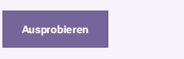          | 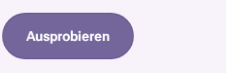          |
| IconButton hell   | 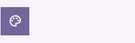  |   |
| Button dunkel     | 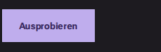         | 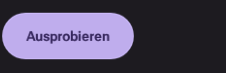         |
| IconButton dunkel | 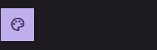 | 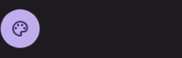 |

Produktionskontext:
[Button hell](after-app-button-light-press.png),
[Button dunkel](after-app-button-dark-press.png),
[IconButton hell](after-app-iconbutton-light-press.png),
[IconButton dunkel](after-app-iconbutton-dark-press.png).
Die entsprechenden main-Aufnahmen haben das Präfix `before-`.
Native Tastaturfokusringe:
[Button hell](after-app-button-light-focus.png),
[Button dunkel](after-app-button-dark-focus.png),
[IconButton hell](after-app-iconbutton-light-focus.png),
[IconButton dunkel](after-app-iconbutton-dark-focus.png).
Galerie-Fokusbilder stehen unter denselben Namen mit `gallery` statt `app`.

## Tatsächlich gezeichneter innerer Fokusring

Die CSS-Pixel-Aufnahmen sind exakt die Eingaben des gemeinsamen AP19-Bilddecoders.
Die Gegenprobe setzt am Kandidaten nur die Oberflächenstapelung auf `auto` zurück;
sie ist kein weiterer main-Build und keine bearbeitete Grafik.

| Engine   | Kategorienkarte                                              | Gegenprobe: Ring überdeckt                                                 | Einheitenkarte                                             |
| -------- | ------------------------------------------------------------ | -------------------------------------------------------------------------- | ---------------------------------------------------------- |
| Chromium | 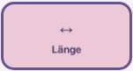 | 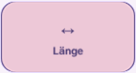 | 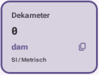 |
| Firefox  | 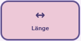   | 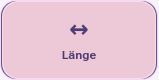   | 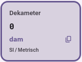   |
| WebKit   | 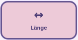     | 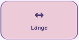     | 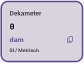     |

Die Pixelzahlen und die unveränderte Mindestgrenze liegen unter
`button-contract-focus-pixels-*` in `interactions.json.gz`. Positive und
Gegenbilder werden vor den Assertions angehängt. Der Ring muss die Farbfläche
eines überdeckten dünnen Rands deutlich überschreiten; reine CSS-Outlinewerte
reichen nicht.

## Rohdaten

- [summary.json](summary.json): 24 Vorher-/24 Nachherfälle mit Radiusgrenzen,
  Nullradius-Frames, verschiedenen Transformwerten und maximaler Messdauer.
- [frames-before.json.gz](frames-before.json.gz) und
  [frames-after.json.gz](frames-after.json.gz): originale rAF-Werte einschließlich
  Ruhezustand, Buildziel, Source-SHA, vier Ecken, gemeinsamer Content-Transformation,
  Hit-/Fokus-Geometrie sowie Eingabe-/Frame-/Messzeiten.
- [interactions.json.gz](interactions.json.gz): Wiederholung, reine Tastatur,
  Pointercancel, Selected-Endpunkte, Disabled, Motion-/OS-Abbruch und Fokuspixel.
- [keypad-frames.json.gz](keypad-frames.json.gz): ursprüngliche AP19-Erweiterung
  für Ziffern, Operatoren, Gleich, Löschen, Speicher und wissenschaftliche Tasten.
- [images.json](images.json): ursprünglicher Trace und Attachmentname jedes PNGs.
- [provenance.json](provenance.json), [budget.json](budget.json) und
  [sha256.json](sha256.json): Buildzuordnung, tatsächliches Startbudget und
  Prüfsummen aller Belegdateien außer der Prüfsummendatei selbst.

```sh
gzip -dc docs/ap42/frames-after.json.gz > frames-after.json
gzip -dc docs/ap42/interactions.json.gz > interactions.json
```

Die ZIP-Traces des verlinkten Actions-Artefakts enthalten weitere Originalbilder
aller drei Engines. Die hier gesicherten PNGs wurden daraus bytegleich übernommen.
Die Rohwerte belegen zeitliche Zustände und Geometrie; physische Monitor-FPS und
hörbare Screenreader-Ausgabe bleiben Plattformabnahme. Firefox/WebKit verwenden
den bestehenden Clipboard-Adapter. Die spätere Live-/Pages-Abnahme bleibt AP41
und [Issue #22](https://github.com/sl3ndrr/m8e-calc/issues/22).
