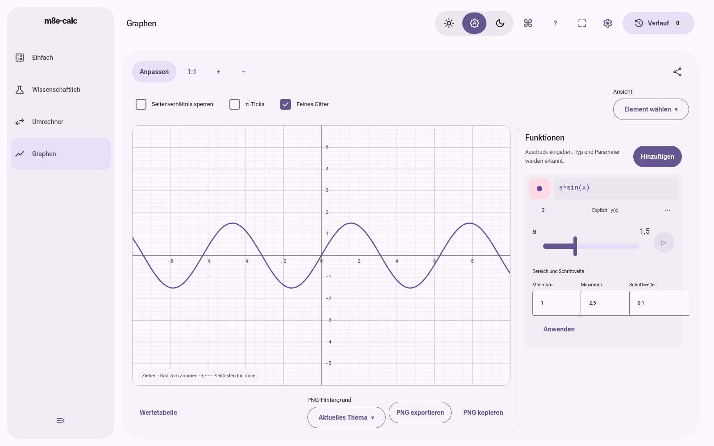
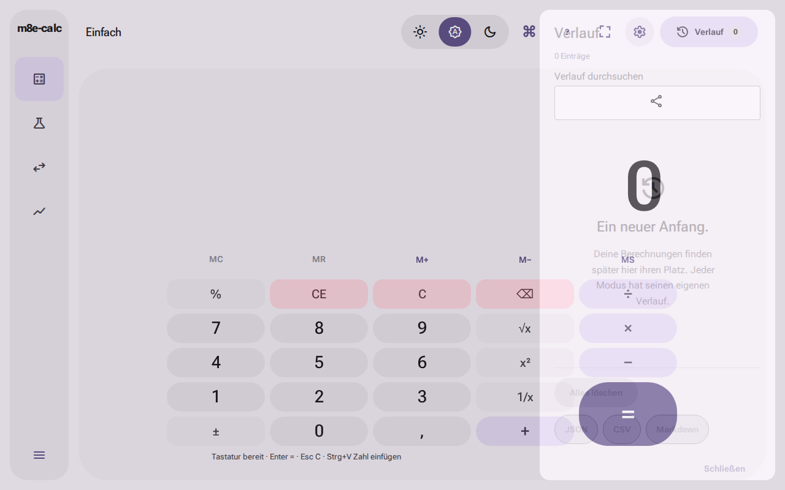
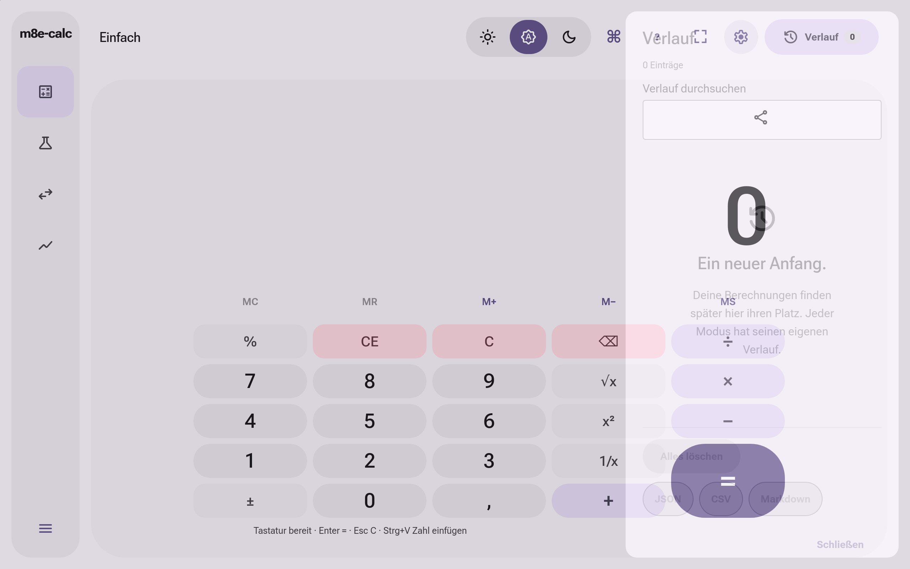
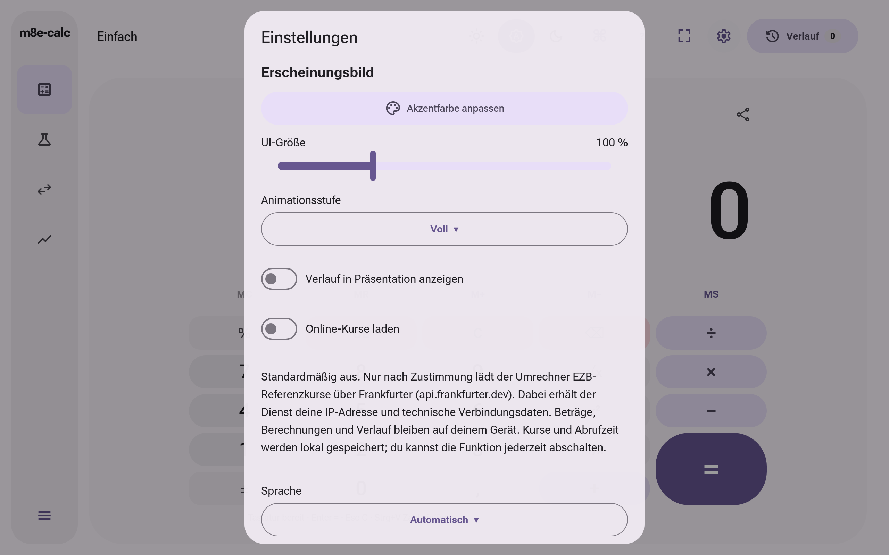
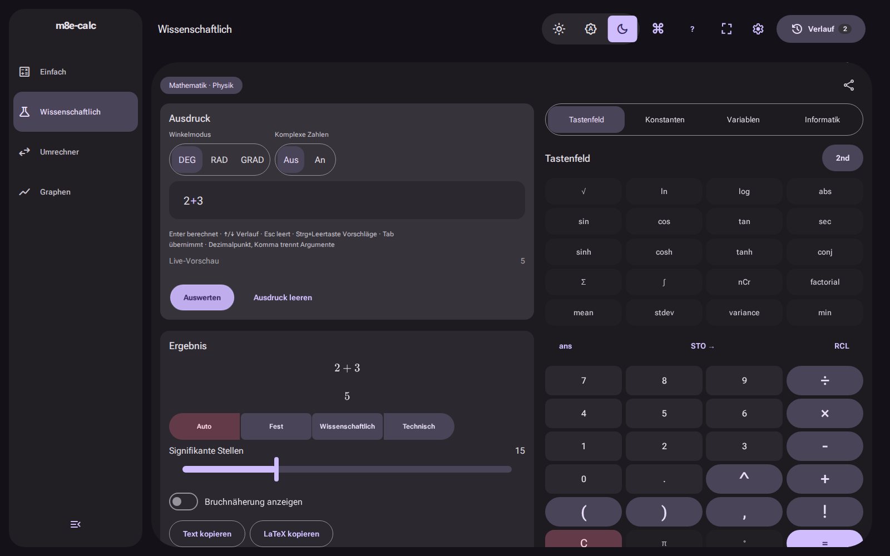
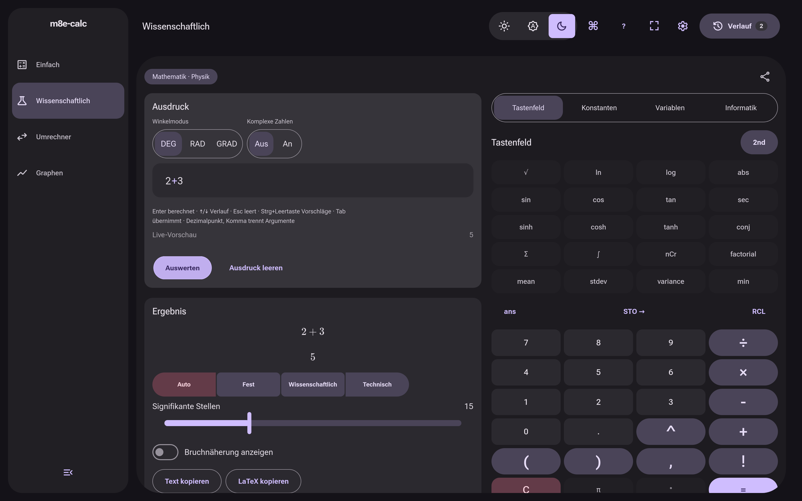

# Finaler AP49-Bild- und Framenachweis

Produkthead `f6b814e50e1b63bc0dd3a3792f60eaa6bb2814e7`, tatsächlich geprüfter Produktionsbuild `f7292b0695b36c4c7b6d7bba998a08c391c86cd1`.
Dieser separate Belegcommit verändert den PR-Produktbaum nicht und ist kein Deployment.

[Pflichtlauf39685901754](https://github.com/sl3ndrr/m8e-calc/actions/runs/39685901754) erfolgreich. Manifest enthält echte Rohdatenprüfsummen, genaue Artefakt-IDs und Bilddatei-Hashes. Historische rote Läufe bleiben in PR69/AP49 erhalten.

Die transparenten Overlaybilder sind absichtlich Zwischenframes. Rollen-/Fokus-/Escape- und Warmstartassertions liegen im erfolgreichen Browserfall. Die Bilder zeigen keine Live-Pages-Fassung. Die Server-/Client-/Worker-Abnahme folgt AP39 separat.

Fünf Kurvenarten in drei Engines: jeweils mehr als10s, null Leer-/Revealframes; in jedem der letzten zehn Einsekundenfenster mindestens3 tatsächlich gezeichnete Signaturen. Nach Pause stimmen angeforderte/akzeptierte/gerenderte Signaturen bytegenau überein. Die15 Kurvenfälle sind bereits Teil der Browserzahlen, keine15 zusätzlich unabhängigen Erfolge.

Normal und Pages:143Dateien/3252338Bytes unabhängig identisch geprüft; genaue Produceridentität und Fingerprint im Manifest. Kein GPU-/Screenreader-/OS-Installationsnachweis.

## Aktuelle native Button-/Overlay-Verträge
[39733546772](https://github.com/sl3ndrr/m8e-calc/actions/runs/39733546772):141 bestanden, zwölf Galerie-Buttonfälle an der Buildkennung gestoppt; der gesamte Lauf bleibt rot. Normalbytes sind exaktf729; separate Galerie aus Checkoutf6 meldete fälschlich den Workflow-SHA2d. Keine Behauptung eines insgesamt grünen Laufs.
Konkrekte Prüfhüllenkorrektur: vor dem separaten Galerie-Build GITHUB_SHA ausdrücklich im Shellprozess exportieren. Keine Quelle oder Assertion geändert.
[39734911249](https://github.com/sl3ndrr/m8e-calc/actions/runs/39734911249):genau die zwölf fehlenden Galerie-Buttonfälle bestanden, korrekte Buildkennungf729, alle Normalbytes vor/nach exakt verifiziert. Keine Wiederholung der141 erfolgreichen Fälle, keine überlappende Addition.

[native-production-summary.json](native-production-summary.json) enthält ausgewählte tatsächlich erfolgreiche Produktionsfälle aller drei Engines: je96 Kalt-/Warm-/Releaseframes, konstante Ecken/Trefferflächen und enthaltener Inhalt. Diese Fälle sind Teil der141, keine zusätzlichen Tests.
[native-gallery-summary.json](native-gallery-summary.json) bindet die zwölf korrigierten Galerieprüfungen.

PR69 wurde nach grüner Pflicht-CI und abgeschlossenen Zusatzprüfungen auf main`fad008b1045e781c8efdac961a728453fd944c11` integriert. Vollständiger Git-Baum identisch mitf6/f729:`5cd65065187c9bcde0bbb24ac391effc3fc66539`. Diese Bilder bleiben ausdrücklich dem geprüften PR-Buildf729 zugeordnet; main-CI/Pages/Live-Fassung werden separat im PR dokumentiert.
