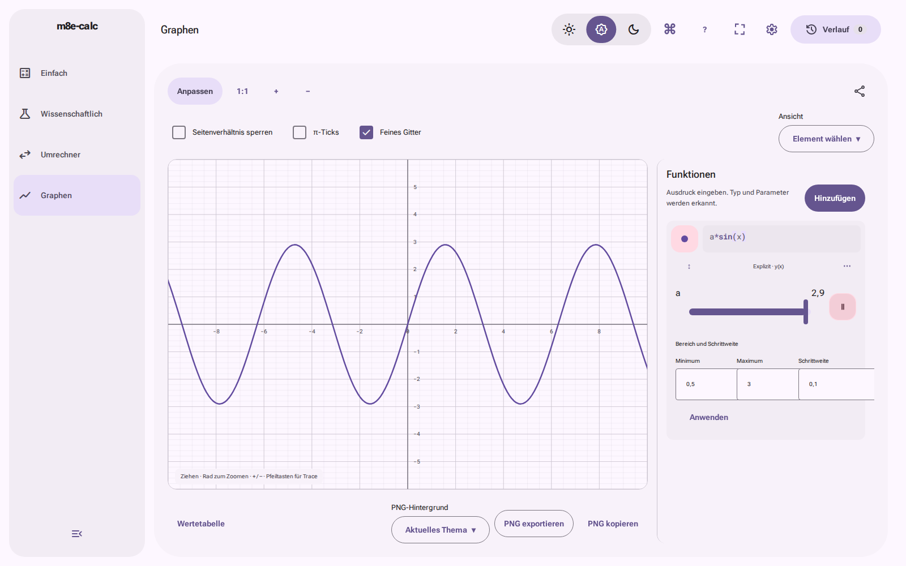

# Integrierte Abnahme AP46/AP49 · 22.10.2026

[PR69](https://github.com/sl3ndrr/m8e-calc/pull/69) ist nach ausdrücklicher Nutzerfreigabe und erfolgreichen finalen Prüfungen integriert.
**main/Produkt-/protokollierter Pages-SHA: `fad008b1045e781c8efdac961a728453fd944c11`.**
[Automatische main-CI39735706918](https://github.com/sl3ndrr/m8e-calc/actions/runs/39735706918) erfolgreich; [Deploy119688156898](https://github.com/sl3ndrr/m8e-calc/actions/runs/39735706918/job/119688156898) meldet exakt diesen pages_build_version und Erfolg **22.10.2026,09:04:51.574 MESZ**. Aktive Live-Clientfassung bleibt unbekannt.

| Befund | Status | Tatsächlicher Bezug |
| --- | --- | --- |
| check unter Node 24 aktuell/Mindestversion, Pipelineverträge, Pflichtgates | bestanden | main fad008b1,39735706918; je 488 UI /1666 Engine, keine addierten Doppelzählungen |
| Chromium/Firefox/WebKit, vier Modi, AP25-Matrix, kalte/warme Lazy-Pfade, Settings/Escape/Fokus | bestanden | main fad008b1:193/166/166; Firefox/WebKit je zwei bestehende Clipboard-Skips,0 flaky |
| Fünf Graphkurven je Engine, Slider/Playback/Pause | bestanden | main fad008b1:12,42–14,69 s;0 Leer-/Revealframes; pro letztem Einsekundenfenster mindestens drei gezeichnete Signaturen; Pause exakt angefordert=akzeptiert=gerendert |
| Native Buttons/Overlayframes/Umkehr/OS-Reduktion/Off | bestanden | versiegelter PR-Build f7292b06, Sourcef6:141 Fälle in39733546772 +12dort vor Interaktion gestoppte Galerie-Buttonfälle nach konkreter Prüfhüllenkorrektur in39734911249. Nicht überlappend. main hat denselben vollständigen Git-Baum; alle Appbytes sind identisch, nur build-info korrekt verschieden |
| Feste 4K-Fenster, Slow-Controls, Mixed2D, Idle, AP21Fit | bestanden | main fad008b1:Pan 60,003 /60,003 /60,003 FPS; Standard4K RenderP950,7ms, Mixed2D0,4ms; Rohdaten/Runner in graph-summary.json |
| Kontrast/Fokus, bestehende Bildreferenzen, Startbudget, PWA/AP29 | bestanden | main fad008b1;190844 /200000 B Start-JS;384 Schemata /36480 Kontrastprüfungen;36 AP29-Fälle; keine neuen pauschalen Baselines |
| Normal-/Pages-Provenienz | bestanden | main fad008b1:143 Dateien /3.252.338 Bytes vollständig unabhängig identisch; Fingerprint und TAR-Hash im Manifest |
| Historischer echter 4K-Fehler | fehlgeschlagen, erhalten | Build9fafd334,39662444234 Versuch1:42,861/42,860/42,606FPS. Versuch2 stoppte vor Tests an Laufversuchsbindung; kein neuer FPS-Befund |
| Historischer Quellen-/Prüfhüllenfehler | fehlgeschlagen, erhalten | 39682150755/39683429919:Artefaktlink404/JPL-Timeout;39733546772:zwölf falsche Galerie-Buildkennungen. Nach belegter Korrektur neue Prüfungen grün; alte Gesamtläufe bleiben rot |
| AP39 Live-JSON/Assets/Worker/frischer und kontrollierter Client/Update/Reload/Offline/Kernabläufe | blockiert | nach erfolgreichem fad-Deploy beide direkte URLs erneut Forbidden; genaue Versuche unten |
| Physische GPU/Screenreader/OS-Installation/Firefox-/Safari-Menüzoom | nicht geprüft | Headless/Emulation ersetzt diese Abnahme nicht |

Die fünfzehn Kurvenfälle sind bereits Teil der Browserzahlen. Die64 Pixelvergleiche pro Engine sind je eine Testidentität, keine 192 zusätzlich unabhängigen Erfolge. Lighthouse folgt seinem **unveränderten Medianvertrag**:98–99Punkte. Ein Einfach-Einzellauf74/TBT537,485ms vom22.10. **06:46:00.828UTC /08:46:00.828MESZ**; Median 99. Kein Nachlauf zur Auswahl eines günstigen Werts. Rohbefund im Manifest/QA-Artefakt erhalten.

## Drei ursprüngliche Nutzerprobleme
- Buttonoberfläche und Inhalt behalten ihre Form und gemeinsame Skalierung bei schnellen Druck-/Release-/Umkehr-/Abbruchfolgen; Produktions- und Galerieverträge einschließlich kaltem/warmem Druck erfolgreich. [Native Zwischenbilder](../ap49-final/README.md).
- Graphslider und langes Playback zeigen fortlaufende Geometrie ohne erneuten Reveal; Pause übernimmt den letzten tatsächlichen Parameter. Aktuelle vollständige Signatur-/Framemetriken im Manifest.
- Akzentfarbe/Installation liegen in Einstellungen. Kalter und warmer Pfad, Exit→neuer Settings-Klick, verschachteltes Escape/Fokus sowie unterstützter PWA-Promptvertrag erfolgreich. Physische OS-Installation bleibt ungeprüft.

Diese Aufnahme stammt aus main-Artefakt 12407438039; ihr PNG ist byteidentisch mit der unabhängig aufgenommenen PR-Aufnahme. Zuordnung erfolgt über den frischen Lauf und seine gebundenen Frame-/Pause-Daten, nicht über den Bildinhalt allein.

## Provenienz
Vollständiger Git-Baum von Headf6, PR-Buildf729 und mainfad:
`5cd65065187c9bcde0bbb24ac391effc3fc66539`.
Normal12406493695 und Pages12406947621; Fingerprint
`9d361ccc39283f52e7aaf831775435b6e2a58a42f50c6adbf2e8dc0ab4a831a0`.
TAR-SHA256
`24c1a8fd72a218efba22e9ae6eb4489ba3475f6925085ea1d215dc922b6e0267`.
Jede Datei und der exakte Producerkontext inklusive Laufversuch wurden unabhängig geprüft. Die Quellenangabe SOFA ersetzte die wiederholt unerreichbare JPL-Adresse; alle 274 numerischen Referenzzeilen blieben unverändert. Kein Quellenchecker-/Zeitgrenzen-/Retry- oder Performancegrenzen-Workaround.

## AP39 nach dem tatsächlichen Deploy
Cloud-Browser Chrome, genaue OS-/Browserversion nicht freigegeben:
- `https://sl3ndrr.github.io/m8e-calc/`, direkter neuer Tab22.10.2026 **09:05:46.544MESZ**.
- `https://sl3ndrr.github.io/m8e-calc/build-info.json`, direkter neuer Tab **09:06:04.211MESZ**.
- Beide sichtbar exakt **Forbidden. Calls to this URL are not allowed.** Screenshots09:06:59.037/.077MESZ.
- Kein Netz-JSON geparst; keine aktive HTML-/Asset-/Graphworker-/Serviceworkerfassung festgestellt. Frischer/kontrollierter Client, Update/Reload/Offline und Live-Kernabläufe bleiben blockiert. Keine Umgehung, keine Websiteausfallbehauptung. Artefakt-Buildinfo und erfolgreicher Deploy beweisen keine im geöffneten Client aktive Fassung.

## Issues / Restpunkte
- **#43:Schließung empfohlen** aufgrund seines eigenen Rasterdiagnose-/AP28-Vergleichsvertrags:kontrolliertes rotes Original vs einmaliger Kandidat,31,8 % weniger normierte DoUpdateLayers-Zeit, unverändert erfolgreiche finale PR-/main-Gates. Historische rote Läufe bleiben erhalten.
- **#22:offen**, eigene AP39-Livekriterien fehlen; ursprüngliche Timeoutursache14.10. weiter ungeklärt.
- **#70/#71:offen**, Harness-/Browserverträge erfolgreich, genaue historische Ursachen nicht aus grünen Läufen abgeleitet.
- **#32:offen, integrierte Teile korrekt erledigt**:jsdom30.1.3/Vitest5.0.5/Motion14.4.0 und Node 24-Vertrag; Material/F6 bleibt.
- **#31/#50 und #33/#37/#39:offen**:keine neue veröffentlichte Voraussetzung/Tarball- und separate Migrationsabnahme in diesem Paket behauptet, integrierter geprüfter Ersatz fehlt.
- AP32:Ruleset25003991 aktiv, strikt aktuelles Quality gate/App15368, PR-Pflicht, keine Bypassakteure. Existierender PR33 erzeugt roten Pflichtcheck118937470963, ist zugleich hinter main. Isolierter frischer roter Dependabot-Fall weiterhin offen; keine kaputte Abhängigkeit/Regeländerung erzeugt.
- Lighthouse-Einzelbeobachtung74 bleibt offen dokumentiert; kein aus einem Ausreißer erfundener Produktfehler.

## Praktische Handliste außerhalb dieser Umgebung
1. Frisches und vorhandenes kontrolliertes Testprofil getrennt:netzgebundene Buildinfo und tatsächlich geladene HTML-/JS-/CSS-/Lazy-/Graphworker-/SW-Bytes dem fad-Deploy zuordnen. Alte App darf trotz neuer Serverinfo nicht als aktualisiert gelten.
2. Updateangebot/gezielte Aktivierung/Controllerwechsel/Reload und echte Offline-Unterbrechung prüfen:JSON muss offline fehlschlagen, vier vollständig vorgecachte Modi müssen offline funktionieren. Fehlt alter kontrollierter Client, bleibt dieser Updatefall offen.
3. AP25-Paarmatrix in drei Desktopbrowsern de/en, Hell/Dunkel, Full/Reduced/Off/OS-Reduktion bei 1280 /1920 /3840 und echtem 100/125/150/200%-Menüzoom; Kernrechnungen/Fehler, langer Tabpfad, Export/Restore/Permalink, stabile zwölf Fits und Mixed2D prüfen.
4. Auf physischer 4K/GPU schnelle Buttons, mindestens 10 s Slider/Playback/Pause-Endwert, kalte/warme Einstellungen/Akzent/Installation und verschachteltes Escape/Fokus; hörbaren Screenreader und OS-Installation separat belegen.

Nur Schließempfehlungen; kein Issue automatisch geschlossen. Kein Tag, Release oder manueller Pages-Deploy. Dieser separate Belegcommit verändert den Produktbaum nicht.
